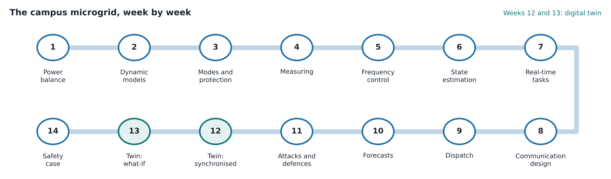

# Cyber-Physical Systems

**BIL-435 Siber Fiziksel Sistemler. Undergraduate elective course, Department of Computer Engineering, Süleyman Demirel University, Isparta, Türkiye**

*A 14-week undergraduate course with lecture pages, 3D virtual laboratories of real hardware, Colab notebooks that simulate and analyse a campus microgrid, development templates and a Python track for beginners*

         

**This course is updated in line with current developments in the field. First version: November 2026.**

**Prof. Dr. Utku Kose**

Full Professor, Department of Computer Engineering, Süleyman Demirel University, Isparta, Türkiye  
Founding Director, AI Application and Research Center (YAZEM), Süleyman Demirel University  
Head of the Computer Science Division, Department of Computer Engineering, Süleyman Demirel University  
Additional affiliations: University of North Dakota (USA), Universidad Panamericana (Mexico City, Mexico), Vel Tech University (Chennai, India)  
IEEE Senior Member, ACM Professional Member

[ORCID 0000-0002-9652-6415](https://orcid.org/0000-0002-9652-6415) | [utkukose.com](https://www.utkukose.com) | [github.com/utkukose](https://github.com/utkukose)

[utkukose@sdu.edu.tr](mailto:utkukose@sdu.edu.tr) | [utku.kose@und.edu](mailto:utku.kose@und.edu) | [ukose@up.edu.mx](mailto:ukose@up.edu.mx) | [utkukose@gmail.com](mailto:utkukose@gmail.com)

## About the course

Cyber-physical systems (CPS) integrate computation, networking and physical processes: Embedded computers and networks monitor and control the physical processes, usually with feedback loops in which the physical processes affect the computations and the computations affect the physical processes [1, 2]. They run power grids, factories, buildings, vehicles and medical devices, and their design joins computer engineering with control and physics [3, 4]. This repository holds the open materials of the undergraduate course Cyber-Physical Systems (Siber Fiziksel Sistemler) of the Department of Computer Engineering at Süleyman Demirel University. Over fourteen weeks, the course leads from the feedback loop and the models of continuous, discrete and hybrid dynamics to sensors, actuators, feedback control and estimation. It continues with embedded computing, real-time scheduling and the networks that connect the devices, and then with optimisation, learning from data and the security of CPS. Two weeks build a digital twin of the running project, and the last week turns to dependability, safety and verification.

Cyber-physical systems are learned best at the bench. Every week therefore holds a 3D virtual laboratory in its interactive lab, where the hardware stands in the foreground: Controllers, meters, inverters, batteries, cables, oscilloscopes and network devices that the student wires, configures and tests. The results of these experiments feed the Colab notebook, where Python turns them into the models and measures of the lecture. Every week also adds a working development template to the [`templates/`](templates/README.md) folder, a small program that can be reused in projects. The [syllabus](SYLLABUS.md) sets out the course information, the learning outcomes, the weekly plan, the assessment and the course policies. The sections below explain how the materials of a week fit together and where to find them.

## Use in other courses

These materials were prepared for the undergraduate course Cyber-Physical Systems at Süleyman Demirel University. They are openly available: Anyone may use and adapt them in courses of related content, at any level, with attribution as described in the license section. Instructors who adopt them are welcome to report errors or suggest improvements through the issues of this repository.

## A look inside

Every lecture page holds an interactive scene in three dimensions, and every interactive lab holds a 3D virtual laboratory with the hardware of the week, which records the student's own experiments. A click on a picture opens its page.

<table><tr><td width="33%" valign="top"> Week 8: The Modbus bench</td><td width="33%" valign="top"> Week 8: The scene A trip in the substation</td><td width="33%" valign="top"> Week 8: Control over the network</td></tr></table>

## Who the course is for

The course is written for third- and fourth-year undergraduate students of computer engineering and related programmes, and for self-learners anywhere. Programming experience in any language helps, but it is not required. The start-here Colab notebook and the fourteen Python steps teach the Python needed for the course through the project itself. Students who already program in Python can treat the Python steps as a quick review and spend the time on the exercises, the development templates and the research assignments.

## Course learning outcomes

On completion, students are expected to:

1. Explain what makes a system cyber-physical, describe its feedback loops and model the power balance of a microgrid.
2. Model continuous, discrete and hybrid dynamics with differential equations and state machines, and simulate them.
3. Describe sensors and actuators with sampling, quantisation and noise, and design feedback controllers of the P, PI and PID type for stability and performance.
4. Estimate the state of a physical process from noisy measurements with filters such as the Kalman filter, and detect bad data.
5. Analyse the timing of embedded and networked systems, including real-time schedules, fieldbuses, publish-subscribe messaging and the effect of network delay on control loops.
6. Optimise the operation of an energy system, forecast its loads and generation, and detect anomalies and attacks.
7. Build, synchronise and calibrate a digital twin of a cyber-physical system and use it for what-if analysis and predictive maintenance, with attention to dependability and safety.
8. Write and run Python programs in Google Colab that simulate, control and analyse cyber-physical systems.

## How the course works

Each week has an overview page in its folder, which links to four materials with distinct roles. The lecture page explains the concepts with formulas, worked examples, an interactive scene, animations, knowledge checks and review cards. The Colab notebook holds the Python step of the week and the hands-on work on the campus microgrid, with exercises that give immediate feedback and reference solutions in collapsed cells. Each of its sections links back to the part of the lecture that it applies, and each can be started on its own. The interactive lab turns the ideas into practice. It holds 3D virtual laboratories with the hardware of the week, step-by-step calculators for the worked examples and a calculation by hand. The results of the experiments can be copied into the Colab notebook, where they become the data of the week. The interactive lab closes with a self-assessment and an exportable learning log. The PDF lecture notes collect the Python step and the lecture in one printable file.

The course works in two modes. In a synchronous delivery, each week runs as one session of about three hours, following the live session plan on its overview page. In asynchronous study, the same materials are used along the study path on the overview page, which lists every activity with a suggested time. Earlier work on software support for self-learning in computer engineering courses informed this structure [5].

Students who have never programmed start with [`start-here/`](start-here/README.md) and then follow the weeks in order. The course site at <https://utkukose.github.io/cyber-physical-systems-NB-lecture/> links every page and keeps track of the completed knowledge checks in the browser.

## The campus microgrid, the project of the course, week by week

One project runs through the whole course: The microgrid of a university campus, called *the campus microgrid*. It joins a solar plant, a wind turbine, a battery, five buildings and a car park with chargers for electric vehicles, and it can run connected to the city grid or on its own as an island [6]. The campus, its devices and its data are invented, so that every number can be computed and checked. Each week first teaches its methods on small examples and then takes the microgrid one stage further, in a lecture section titled *The campus microgrid, stage N*. The figure shows the fourteen stages, and the table links each published stage to its section.

| Week | Stage of the project | Methods | Result |
|---|---|---|---|
| Week 1 | The power balance of the campus | Feedback loops, energy and power, the balance of supply and demand | In preparation |
| Week 2 | Dynamic models of the battery, a building and the frequency | Differential equations and their simulation | In preparation |
| Week 3 | Operating modes and protection | State machines, hybrid automata, relays | In preparation |
| Week 4 | Measuring the microgrid | Sampling, quantisation, noise, smart meters | In preparation |
| Week 5 | Frequency control by the battery | P, PI and PID control, stability | In preparation |
| Week 6 | Estimating the state of the microgrid | Kalman filter, state estimation, bad data | In preparation |
| Week 7 | Real-time tasks of the microgrid controller | Rate-monotonic and earliest-deadline-first scheduling, PLC scan | In preparation |
| [Week 8](https://utkukose.github.io/cyber-physical-systems-NB-lecture/weeks/week-08/lecture.html#the-campus-microgrid-stage-8) | The communication design with a delay budget | Modbus, MQTT, IEC 61850 GOOSE, queues, delay margin | The Modbus bus of the battery container polls its three devices in 129.6 ms at 19200 baud, and publishing on change cuts the meter traffic from 1,728 to 199 messages an hour. Four copies of a trip keep the chance of a missed trip at 1.6 × 10⁻⁷, and the frequency loop through the campus server keeps 62.7 percent of its delay margin of 1.072 s |
| Week 9 | The dispatch of the microgrid | Economic dispatch, battery scheduling, demand response | In preparation |
| Week 10 | Forecasts of load and generation | Regression, time series, anomaly detection | In preparation |
| Week 11 | Attacks and defences | False data injection, detection, resilience | In preparation |
| Week 12 | A digital twin that follows the microgrid | Synchronisation, calibration | In preparation |
| Week 13 | What-if analysis and maintenance with the twin | Scenarios, remaining useful life | In preparation |
| Week 14 | The safety case of the microgrid | Reliability, fault trees, verification | In preparation |

In the final project, each student builds a smaller cyber-physical system of their own choice along the same stages: A model, a controller, a communication design, a digital twin and a safety argument.

## Weekly schedule

| Week | Topic | Week overview | Lecture page | Interactive lab | Colab notebook | PDF lecture notes |
|---|---|---|---|---|---|---|
| 1 | Foundations: Cyber-Physical Systems, Feedback Loops and the Power Balance | in preparation | | | | |
| 2 | Continuous Dynamics: Batteries, Buildings and Grid Frequency | in preparation | | | | |
| 3 | Discrete and Hybrid Dynamics: State Machines, Thermostats and Protection Relays | in preparation | | | | |
| 4 | Sensors and Actuators: Sampling, Quantisation, Noise and Smart Meters | in preparation | | | | |
| 5 | Feedback Control: P, PI and PID, Stability and Frequency Control | in preparation | | | | |
| 6 | Estimation and Filtering: The Kalman Filter, State Estimation and Bad Data | in preparation | | | | |
| 7 | Embedded Computing and Real-Time Scheduling: RM, EDF and the PLC Scan Cycle | in preparation | | | | |
| 8 | Networks and Communication: Modbus, MQTT, IEC 61850 and Control over Networks | [Week overview](weeks/week-08/README.md) | [Lecture page](https://utkukose.github.io/cyber-physical-systems-NB-lecture/weeks/week-08/lecture.html) | [Interactive lab](https://utkukose.github.io/cyber-physical-systems-NB-lecture/weeks/week-08/lab.html) |  | [PDF notes](weeks/week-08/Week08_Lecture_Notes.pdf) |
| 9 | Energy Optimisation: Economic Dispatch, Battery Scheduling and Demand Response | in preparation | | | | |
| 10 | Learning from Data: Load and Generation Forecasting, Anomaly Detection | in preparation | | | | |
| 11 | Security of Cyber-Physical Systems: False Data Injection and Defences | in preparation | | | | |
| 12 | Digital Twins I: Synchronisation and Calibration | in preparation | | | | |
| 13 | Digital Twins II: What-If Analysis and Predictive Maintenance | in preparation | | | | |
| 14 | Dependability, Safety and Verification | in preparation | | | | |

## Python for non-programmers

Python is taught step by step alongside the content of the course, always through the tool that the campus microgrid of the week needs [7]. Every week has a Python step in its Colab notebook, right after the setup section. It explains one group of fundamentals with runnable cells and closes with a quick check and three exercises. The steps start with values, variables, lists and decisions and continue with NumPy arrays, simulation loops, classes and plots [8, 9, 10]. Later steps add bytes and binary messages, optimisation and fitting with SciPy [11], events and queues, and organised, tested code.

The full sequence is described in [`PYTHON_PATH.md`](PYTHON_PATH.md).

## Development templates

Each week adds a development template: A small, working Python program that carries out one method of the week and can be reused in projects. The templates run with the Python standard library and NumPy unless their header states otherwise, and each starts with a description, its inputs and outputs, and an example run. The list is in [`templates/`](templates/README.md).

## Assessment and submission

Assessment rests on two projects, each a coding application with a short technical report. The midterm project at the end of Week 7 models a small cyber-physical system of the student's choice with the methods of Weeks 1 to 7, designs a controller for it and checks its timing. The final project at the end of Week 14 adds a communication design, an optimisation or a forecast, a digital twin and a safety argument. The midterm component counts 40 percent of the course grade and the final project 60 percent. Each week also offers an optional task, an optional research and report assignment and a self-assessment in the interactive lab. The optional work carries no separate weight. It is combined with the midterm component, and the instructor may take it into account as a discretionary adjustment. During an active semester, the deadlines are announced by the instructor, and the optional work can be sent to utkukose@sdu.edu.tr or utkukose@gmail.com.

| Component | Timing | Format | Weight | Page |
|---|---|---|---|---|
| Weekly task and learning log (optional) | End of each week | Short coding task and exported log | Discretionary adjustment of the midterm component | each week folder |
| Midterm project: A model and a controller for a cyber-physical system | End of Week 7 | Coding application and technical report | 40 % | [open](exams/midterm/README.md) |
| Final project: A networked cyber-physical system with its digital twin | End of Week 14 | Coding application and technical report | 60 % | [open](exams/final/README.md) |

Reports are written in the Word template [exams/REPORT_TEMPLATE.docx](exams/REPORT_TEMPLATE.docx). The [syllabus](SYLLABUS.md) states the policies, including the rules for using generative AI tools.

## Running the materials

The Colab notebooks run in Google Colab through the badge of each week, with no installation at all: The course uses only NumPy, pandas, SciPy, Matplotlib, scikit-learn and ipywidgets. For local work on Windows or Ubuntu, create a virtual environment with `python -m venv .venv`, activate it, run `pip install -r requirements.txt` and start `jupyter lab`. The lecture pages and interactive labs open in any modern browser and keep progress only in that browser. The 3D parts of the pages use a local copy of three.js in `assets/vendor` and the human figures in `assets/models`, so they also run when the repository is downloaded and opened offline.

## Reference integrity

All references were checked before release. Entries with a link in `references/REFERENCES.md` were confirmed against that DOI (digital object identifier) or publisher page during preparation, and the remaining entries are fully citable from the details given. No locator was reconstructed from memory. As an independent check, `tools/verify_references.py` compares every entry with Crossref and OpenAlex, and the GitHub Actions workflow runs it monthly and on every change of the references.

## Citing this course

Citation metadata is provided in `CITATION.cff`. A suggested citation is:

> Kose, U. (2026). *Cyber-Physical Systems: Open course materials* [Course materials]. GitHub. https://github.com/utkukose/cyber-physical-systems-NB-lecture

## License

The course text, figures, lecture notes and interactive labs are licensed under the Creative Commons Attribution 4.0 International License (CC BY 4.0), as stated in `LICENSE-CONTENT`. The code in the Colab notebooks, interactive labs and tools is licensed under the MIT License, as stated in `LICENSE`. The bundled copy of three.js keeps its own MIT License, in `assets/vendor/LICENSE-three.txt`. The human figures in `assets/models` are built from the CC0 assets of the MakeHuman project (base mesh, macro targets, skeleton and helper geometry) and are released under CC0 1.0 as well, as stated in `assets/models/LICENSE-models.txt`.

## References cited on this page

[1] Lee, E. A. (2008). Cyber physical systems: Design challenges. In *2008 11th IEEE International Symposium on Object and Component-Oriented Real-Time Distributed Computing (ISORC)* (pp. 363-369). IEEE. <https://doi.org/10.1109/ISORC.2008.25>

[2] Lee, E. A., & Seshia, S. A. (2017). *Introduction to Embedded Systems: A Cyber-Physical Systems Approach* (2nd ed.). MIT Press. <https://ptolemy.berkeley.edu/books/leeseshia/>

[3] Rajkumar, R., Lee, I., Sha, L., & Stankovic, J. (2010). Cyber-physical systems: The next computing revolution. In *Proceedings of the 47th Design Automation Conference* (pp. 731-736). ACM. <https://doi.org/10.1145/1837274.1837461>

[4] Alur, R. (2015). *Principles of Cyber-Physical Systems*. MIT Press. <https://cis.upenn.edu/~alur/pcps.html>

[5] Kose, U., & Arslan, A. (2017). Optimization of self-learning in Computer Engineering courses: An intelligent software system supported by Artificial Neural Network and Vortex Optimization Algorithm. *Computer Applications in Engineering Education*, *25*(1), 142-156. <https://doi.org/10.1002/cae.21787>

[6] Olivares, D. E., Mehrizi-Sani, A., Etemadi, A. H., Cañizares, C. A., Iravani, R., Kazerani, M., Hajimiragha, A. H., Gomis-Bellmunt, O., Saeedifard, M., Palma-Behnke, R., Jiménez-Estévez, G. A., & Hatziargyriou, N. D. (2014). Trends in microgrid control. *IEEE Transactions on Smart Grid*, *5*(4), 1905-1919. <https://doi.org/10.1109/TSG.2013.2295514>

[7] Van Rossum, G., & Drake, F. L. (2009). *Python 3 Reference Manual*. CreateSpace.

[8] Harris, C. R., Millman, K. J., van der Walt, S. J., Gommers, R., Virtanen, P., Cournapeau, D., Wieser, E., Taylor, J., Berg, S., Smith, N. J., Kern, R., Picus, M., Hoyer, S., van Kerkwijk, M. H., Brett, M., Haldane, A., Fernández del Río, J., Wiebe, M., Peterson, P., Gérard-Marchant, P., Sheppard, K., Reddy, T., Weckesser, W., Abbasi, H., Gohlke, C., & Oliphant, T. E. (2020). Array programming with NumPy. *Nature*, *585*(7825), 357-362. <https://doi.org/10.1038/s41586-020-2649-2>

[9] McKinney, W. (2010). Data structures for statistical computing in Python. In *Proceedings of the 9th Python in Science Conference* (pp. 56-61). <https://doi.org/10.25080/Majora-92bf1922-00a>

[10] Hunter, J. D. (2007). Matplotlib: A 2D graphics environment. *Computing in Science & Engineering*, *9*(3), 90-95. <https://doi.org/10.1109/MCSE.2007.55>

[11] Virtanen, P., Gommers, R., Oliphant, T. E., Haberland, M., Reddy, T., Cournapeau, D., Burovski, E., Peterson, P., Weckesser, W., Bright, J., van der Walt, S. J., Brett, M., Wilson, J., Millman, K. J., Mayorov, N., Nelson, A. R. J., Jones, E., Kern, R., Larson, E., Carey, C. J., Polat, İ., Feng, Y., Moore, E. W., VanderPlas, J., Laxalde, D., Perktold, J., Cimrman, R., Henriksen, I., Quintero, E. A., Harris, C. R., Archibald, A. M., Ribeiro, A. H., Pedregosa, F., van Mulbregt, P., & SciPy 1.0 Contributors. (2020). SciPy 1.0: Fundamental algorithms for scientific computing in Python. *Nature Methods*, *17*(3), 261-272. <https://doi.org/10.1038/s41592-019-0686-2>

## Human-AI collaboration

This course was developed through human-AI collaboration. Human intellectual knowledge and expertise are the fundamental starting point of the course. The course author guides and supervises every stage of its development. The final version is presented only after the course author's review and approval.

---

**Prof. Dr. Utku Kose**

Full Professor, Department of Computer Engineering, Süleyman Demirel University, Isparta, Türkiye  
Founding Director, AI Application and Research Center (YAZEM), Süleyman Demirel University  
Head of the Computer Science Division, Department of Computer Engineering, Süleyman Demirel University  
Additional affiliations: University of North Dakota (USA), Universidad Panamericana (Mexico City, Mexico), Vel Tech University (Chennai, India)  
IEEE Senior Member, ACM Professional Member

[ORCID 0000-0002-9652-6415](https://orcid.org/0000-0002-9652-6415) | [utkukose.com](https://www.utkukose.com) | [github.com/utkukose](https://github.com/utkukose)

[utkukose@sdu.edu.tr](mailto:utkukose@sdu.edu.tr) | [utku.kose@und.edu](mailto:utku.kose@und.edu) | [ukose@up.edu.mx](mailto:ukose@up.edu.mx) | [utkukose@gmail.com](mailto:utkukose@gmail.com)

## Acknowledgments

The course draws on the work of the many researchers cited in the weekly references. It was prepared for the Department of Computer Engineering of Süleyman Demirel University. The interactive labs draw their 3D virtual laboratories with three.js, and the Colab notebooks rely on NumPy, pandas, SciPy, Matplotlib, ipywidgets and Jupyter, with Google Colaboratory for cloud execution.
