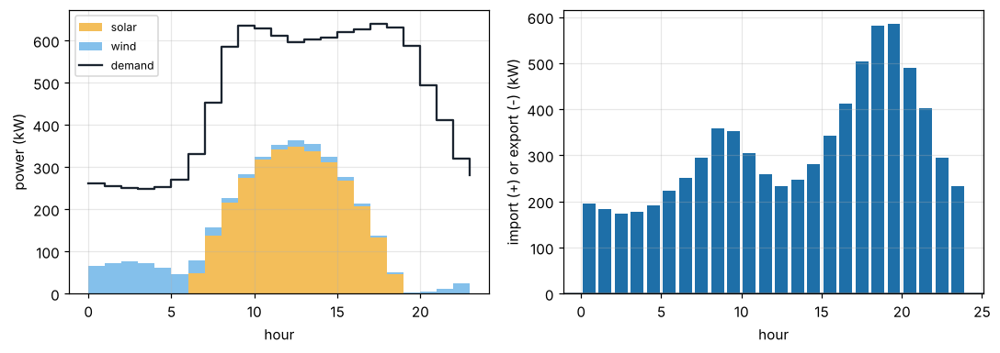
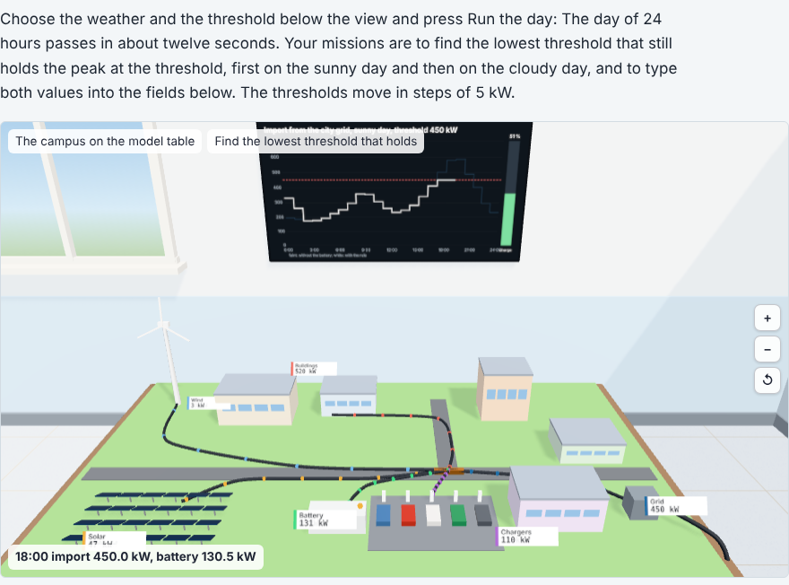

# Week 01: Foundations: Cyber-Physical Systems, Feedback Loops and the Power Balance

**Cyber-Physical Systems (BIL-435 Siber Fiziksel Sistemler)**  
Prof. Dr. Utku Kose, Süleyman Demirel University

   

What makes a system cyber-physical, and how a feedback loop joins sensing, computing and acting. The week introduces the campus microgrid, the project of the course, with its balance of power and energy. It models the solar plant and the wind turbine and closes a first loop that shaves the peak of the import with the battery. Two virtual laboratories in three dimensions (3D) complete the week. **Estimated study time:** 8 to 9 hours.

## Materials of the week

Each material has its own role. Start with the lecture page; the study path below gives the order and the time of each step.

| Material | What it holds | Open |
|---|---|---|
| Lecture page | The concepts of the week, with a 3D scene, an animation, discussion questions, knowledge checks, the development templates, review cards and the references | [Lecture page](https://utkukose.github.io/cyber-physical-systems-NB-lecture/weeks/week-01/lecture.html) |
| Colab notebook | Python step 1: Values, variables, lists and decisions, then five hands-on sections that compute the balance of a day with a battery rule, evaluate the models of the sun and the wind, run the loop of the battery for several gains and compute stage 1 of the campus microgrid, with exercises |  |
| Interactive lab | Foundations lab: Four parts, among them two 3D virtual laboratories (the campus on the model table and the battery controller on the bench), step-by-step calculators, a self-assessment and an exportable learning log | [Interactive lab](https://utkukose.github.io/cyber-physical-systems-NB-lecture/weeks/week-01/lab.html) |
| PDF lecture notes | The Python step and the lecture in one printable file | [PDF notes](Week01_Lecture_Notes.pdf) |

<table><tr><td width="50%"> From the Colab notebook</td><td width="50%"> The interactive lab</td></tr></table>

## Learning outcomes

By the end of the week, students are expected to explain what makes a system cyber-physical and to name its plant, sensors, controllers, actuators and network. They should be able to distinguish open-loop from closed-loop control and compute a proportional action. They should also compute the power balance of a microgrid, its energies and its self-sufficiency, and evaluate simple models of a solar plant and a wind turbine. Finally, they should be able to simulate a first feedback loop and relate its gain to its speed and stability. In Python, students are expected to use variables, lists, loops, decisions and functions.

## Study path

| Step | Activity | Suggested time |
|---|---|---|
| 1 | Read the [lecture page](https://utkukose.github.io/cyber-physical-systems-NB-lecture/weeks/week-01/lecture.html), answer its knowledge checks and think through its discussion questions | 1 hour 45 minutes |
| 2 | Run Python step 1: Values, variables, lists and decisions in the [Colab notebook](https://colab.research.google.com/github/utkukose/cyber-physical-systems-NB-lecture/blob/main/weeks/week-01/NB01_cps_foundations.ipynb#scrollTo=python-step), right after the setup section | 1 hour |
| 3 | Work through the two virtual laboratories of the [interactive lab](https://utkukose.github.io/cyber-physical-systems-NB-lecture/weeks/week-01/lab.html), Parts A and C, and solve Parts B and D | 1 hour 30 minutes |
| 4 | Work through Sections 1 to 4 of the Colab notebook with your own results and solve the exercises | 2 hours |
| 5 | Run one development template of the week and use the application switch of Section 5 | 45 minutes |
| 6 | Take the self-assessment in the [interactive lab](https://utkukose.github.io/cyber-physical-systems-NB-lecture/weeks/week-01/lab.html) (tab: Check yourself) | 20 minutes |
| 7 | Write the reflection in the interactive lab, export the learning log and complete the weekly task below | 45 minutes |

## Live session plan

The week runs as one synchronous session of about three hours in class or online, and each material has one role in it. The lecture page is on the screen. At each orange Colab box, the instructor shows the matching section in a copy of the Colab notebook that has already been run. Students work in their own copy from top to bottom, and each part of the interactive lab follows the part of the lecture that it practises. The PDF lecture notes serve reading after the session, and the study path above serves self-paced study.

| Time | Activity |
|---|---|
| 0:00 to 0:20 | Opening: Cyber-physical systems around us and the campus microgrid, the project of the course. Students open the Colab notebook, save a copy in Drive and run Section 0 |
| 0:20 to 0:45 | Colab, together: Python step 1, ending with the function that computes the import |
| 0:45 to 1:10 | Lecture page, part 1: What makes a system cyber-physical, with the 3D scene The loop of the campus |
| 1:10 to 1:35 | Lecture page, part 2: Energy, power and the balance, the model table of Part A and Section 1 |
| 1:35 to 1:45 | Break |
| 1:45 to 2:05 | Lecture page, part 3: The models of the sun and the wind with Part B and Section 2 |
| 2:05 to 2:35 | Lecture page, part 4: Closing the loop with the animation, the battery controller of Part C and Section 3 |
| 2:35 to 3:00 | The development templates and the engineering side, the campus microgrid, stage 1 with Part D and Section 4, and the closing section on learning machines. After the session: Section 5, the self-assessment, the PDF notes and the weekly task |

## Weekly task and submission

**What to do.** First, choose a building or a household that you know and estimate the hourly demand of a typical day. Second, add a solar plant of a size of your choice and compute the hourly balance, the energies and the self-sufficiency with Section 1 of the Colab notebook. Third, add a battery and the rule of stage 1, and find the lowest threshold that holds the peak. Finally, describe one feedback loop of your building with its sensor, controller and actuator.

**Where to look.** Lecture: Sections "What makes a system cyber-physical", "Energy and power: The balance of the microgrid" and "Closing the loop: Peak shaving with the battery". Interactive lab: Parts A and C. Colab notebook: Sections 1 and 3, and Exercises A and C.

**Example.** A student models a family house with a demand of 14 kWh a day and 5 kW of solar panels. The self-sufficiency is 0.38 without a battery. A battery of 10 kWh with a threshold of 2 kW cuts the evening peak from 3.1 to 2.0 kW.

**What to submit.** A report of about two pages with the demand profile, the balance, the energies, the self-sufficiency, the threshold found and the description of the loop. Add the Colab notebook with the exercises of Week 1 completed.

The task is optional and supports self-learning and a personal portfolio. During an active semester, the items listed under What to submit can be sent together with the learning log exported from the interactive lab to utkukose@sdu.edu.tr or utkukose@gmail.com.

## Research and report assignment (optional)

**Microgrids on university campuses** What do university campuses gain from running their own microgrids, and which technical problems do they meet?

**What to do.** Select eight studies published since 2010 on microgrids of university campuses or similar sites. For each study, note the site, the sources and storage, the control approach and the reported results, such as savings, peak reduction or resilience during outages. Compare the sites with the campus microgrid of the course. Then discuss which results depend on the local climate and which can be transferred.

**Where to start.** Lecture: Sections "What makes a system cyber-physical" and "Energy and power: The balance of the microgrid". The review of microgrid control in the references gives a first entry to the literature.

**Example focus.** A study may report how a campus microgrid kept a hospital running during a storm. Note how long the island lasted and which loads were shed.

The report should be about 1500 words with at least 8 sources, written in the [report template](../../exams/REPORT_TEMPLATE.docx). During an active semester, it can be sent to utkukose@sdu.edu.tr or utkukose@gmail.com.
