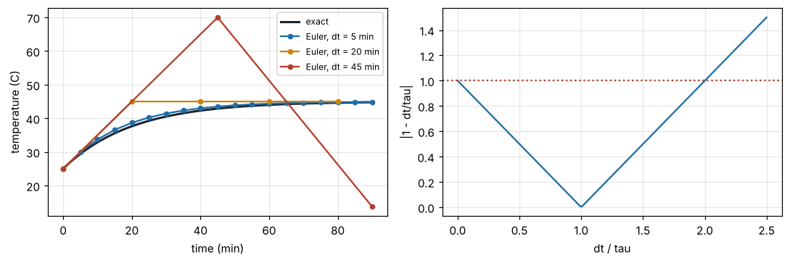
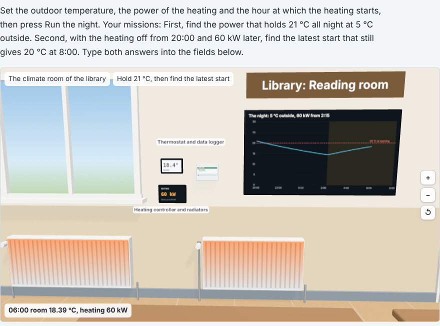

# Week 02: Continuous Dynamics: Batteries, Buildings and Grid Frequency

**Cyber-Physical Systems (BIL-435 Siber Fiziksel Sistemler)**  
Prof. Dr. Utku Kose, Süleyman Demirel University

   

How physical quantities change in time and how a computer simulates them. The week introduces differential equations of the first order, their time constants and the Euler method. It models the state of charge of the battery, the temperature of the library and the frequency of the campus in island mode. Two virtual laboratories in three dimensions (3D), a climate room and a flywheel bench, complete the week. **Estimated study time:** 8 to 9 hours.

## Materials of the week

Each material has its own role. Start with the lecture page; the study path below gives the order and the time of each step.

| Material | What it holds | Open |
|---|---|---|
| Lecture page | The concepts of the week, with a 3D scene, an animation, discussion questions, knowledge checks, the development templates, review cards and the references | [Lecture page](https://utkukose.github.io/cyber-physical-systems-NB-lecture/weeks/week-02/lecture.html) |
| Colab notebook | Python step 2: Simulation loops with NumPy, then six hands-on sections that compare the Euler method with exact solutions, integrate the state of charge, simulate the library and the frequency of the island and compute stage 2 of the campus microgrid, with exercises |  |
| Interactive lab | Continuous dynamics lab: Five parts, among them two 3D virtual laboratories (the climate room of the library and the flywheel bench), a field task with the heat meter of the library, step-by-step calculators, a self-assessment and an exportable learning log | [Interactive lab](https://utkukose.github.io/cyber-physical-systems-NB-lecture/weeks/week-02/lab.html) |
| PDF lecture notes | The Python step and the lecture in one printable file | [PDF notes](Week02_Lecture_Notes.pdf) |

<table><tr><td width="50%"> From the Colab notebook</td><td width="50%"> The interactive lab</td></tr></table>

## Learning outcomes

By the end of the week, students are expected to describe a physical process with a first-order differential equation and to interpret its time constant and steady state. They should be able to simulate it with the Euler method and to choose a step size that is stable and accurate. They should also model the state of charge and the voltage of a battery, the temperature of a building and the frequency of an island. Finally, they should be able to compute a preheating time, a RoCoF and the time of a protective trip. In Python, students are expected to write simulation loops with NumPy arrays and to plot trajectories.

## Study path

| Step | Activity | Suggested time |
|---|---|---|
| 1 | Read the [lecture page](https://utkukose.github.io/cyber-physical-systems-NB-lecture/weeks/week-02/lecture.html), answer its knowledge checks and think through its discussion questions | 1 hour 45 minutes |
| 2 | Run Python step 2: Simulation loops with NumPy in the [Colab notebook](https://colab.research.google.com/github/utkukose/cyber-physical-systems-NB-lecture/blob/main/weeks/week-02/NB02_continuous_dynamics.ipynb#scrollTo=python-step), right after the setup section | 1 hour |
| 3 | Work through the two virtual laboratories of the [interactive lab](https://utkukose.github.io/cyber-physical-systems-NB-lecture/weeks/week-02/lab.html), Parts A and C, and solve Parts B and D | 1 hour 30 minutes |
| 4 | Work through Sections 1 to 5 of the Colab notebook with your own results and solve the exercises | 2 hours |
| 5 | Run one development template of the week and use the application switch of Section 6 | 45 minutes |
| 6 | Do the field task of Part E in the [interactive lab](https://utkukose.github.io/cyber-physical-systems-NB-lecture/weeks/week-02/lab.html): Read the heat meter of the library | 30 minutes |
| 7 | Take the self-assessment in the [interactive lab](https://utkukose.github.io/cyber-physical-systems-NB-lecture/weeks/week-02/lab.html) (tab: Check yourself) | 20 minutes |
| 8 | Write the reflection in the interactive lab, export the learning log and complete the weekly task below | 45 minutes |

## Live session plan

The week runs as one synchronous session of about three hours in class or online, and each material has one role in it. The lecture page is on the screen. At each orange Colab box, the instructor shows the matching section in a copy of the Colab notebook that has already been run. Students work in their own copy from top to bottom, and each part of the interactive lab follows the part of the lecture that it practises. The PDF lecture notes serve reading after the session, and the study path above serves self-paced study.

| Time | Activity |
|---|---|
| 0:00 to 0:15 | Opening: The campus microgrid so far and the question of the week, how its quantities change in time. Students open the Colab notebook, save a copy in Drive and run Section 0 |
| 0:15 to 0:35 | Colab, together: Python step 2, ending with the Euler step next to the exact solution |
| 0:35 to 1:00 | Lecture page, part 1: Differential equations, the time constant and the Euler method with the animation and Section 1 |
| 1:00 to 1:25 | Lecture page, part 2: The battery with the 3D scene Inside the battery container and Section 2 |
| 1:25 to 1:35 | Break |
| 1:35 to 2:05 | Lecture page, part 3: The library as a heat capacitor, the climate room of Part A, Part B and Section 3 |
| 2:05 to 2:35 | Lecture page, part 4: The frequency of the island, the flywheel bench of Part C and Section 4 |
| 2:35 to 3:00 | The development templates and the engineering side, the campus microgrid, stage 2 with Part D and Section 5, and the closing section on learning that respects physics. After the session: Section 6, the field task of Part E, the self-assessment, the PDF notes and the weekly task |

## Weekly task and submission

**What to do.** First, choose a room that you know. Estimate its heat capacity and thermal resistance from a night without heating, or scale the values of the library to its size. Second, simulate a winter night with Section 3 of the Colab notebook and find the latest start of its heater for a comfortable morning. Third, compute the energy that a setback saves. Finally, simulate the same night with the Euler method at three step sizes and report which step you would use, and why.

**Where to look.** Lecture: Sections "Differential equations: How physical quantities change" and "A building as a heat capacitor". Interactive lab: Parts A and B. Colab notebook: Sections 1 and 3, and Exercises A and C.

**Example.** A student models a room of 20 m² with $C = 1.5$ kWh/K and $R = 8$ K/kW, a time constant of 12 h. A heater of 3 kW must start 5.3 h before 7:00 to reach 20 °C from 15 °C at 5 °C outside, at 1:42.

**What to submit.** A report of about two pages with the parameters of the room and their origin, the simulated night, the latest start, the energy saved and the comparison of the step sizes. Add the Colab notebook with the exercises of Week 2 completed.

The task is optional and supports self-learning and a personal portfolio. During an active semester, the items listed under What to submit can be sent together with the learning log exported from the interactive lab to utkukose@sdu.edu.tr or utkukose@gmail.com.

## Research and report assignment (optional)

**Grey-box models of buildings** How well do simple resistor and capacitor models of buildings predict indoor temperatures, and how are their parameters identified from data?

**What to do.** Select eight studies published since 2010 that fit resistor and capacitor models of buildings to measured data. For each study, note the building, the structure of the model, the identification method, the data used and the error of the predictions. Compare the models with the model of the library of the lecture. Then discuss when a simple model is sufficient for control and when a more detailed one is needed.

**Where to start.** Lecture: Sections "A building as a heat capacitor" and "The engineering side: Parameters and validation". The study of Bacher and Madsen in the references gives a first entry to the literature.

**Example focus.** A study may fit models with one, two and three states to a house and compare their errors one day ahead. Note how much each additional state improved the prediction.

The report should be about 1500 words with at least 8 sources, written in the [report template](../../exams/REPORT_TEMPLATE.docx). During an active semester, it can be sent to utkukose@sdu.edu.tr or utkukose@gmail.com.
