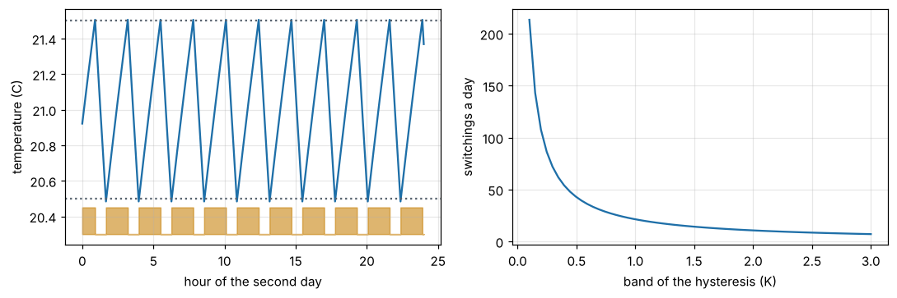
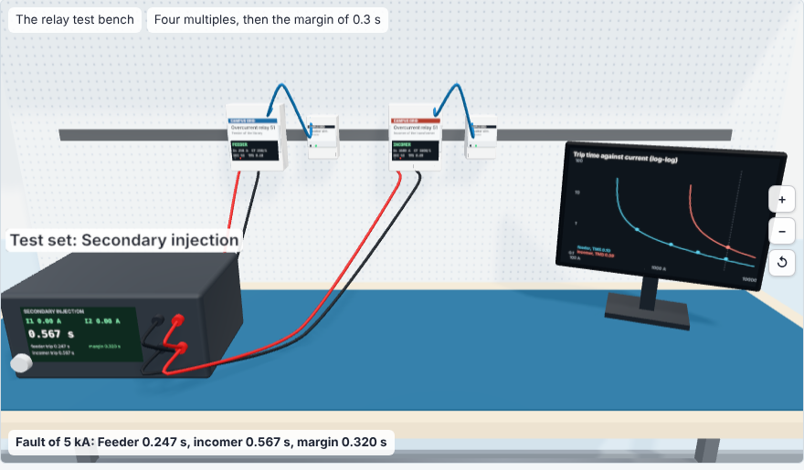

# Week 03: Discrete and Hybrid Dynamics: State Machines, Thermostats and Protection Relays

**Cyber-Physical Systems (BIL-435 Siber Fiziksel Sistemler)**  
Prof. Dr. Utku Kose, Süleyman Demirel University

   

How systems with distinct modes are modelled, simulated and checked. The week introduces finite state machines with their traces and reachable states, and hybrid automata that join modes with differential equations. It applies them to the chargers, the thermostat of the library, the overcurrent relays and the controller that runs the campus as an island. Two virtual laboratories in three dimensions (3D), a relay test bench and the switchboard of the campus, complete the week. **Estimated study time:** 8 to 9 hours.

## Materials of the week

Each material has its own role. Start with the lecture page; the study path below gives the order and the time of each step.

| Material | What it holds | Open |
|---|---|---|
| Lecture page | The concepts of the week, with a 3D scene, an animation, discussion questions, knowledge checks, the development templates, review cards and the references | [Lecture page](https://utkukose.github.io/cyber-physical-systems-NB-lecture/weeks/week-03/lecture.html) |
| Colab notebook | Python step 3: States and transitions, then six hands-on sections that run the charger as a state machine, simulate the thermostat as a hybrid automaton, test the overcurrent relays, run the controller of the microgrid through an outage and compute stage 3 of the campus microgrid, with exercises |  |
| Interactive lab | Discrete and hybrid dynamics lab: Five parts, among them two 3D virtual laboratories (the relay test bench and the switchboard of the campus), a field task with the front panel of the feeder relay, step-by-step calculators, a self-assessment and an exportable learning log | [Interactive lab](https://utkukose.github.io/cyber-physical-systems-NB-lecture/weeks/week-03/lab.html) |
| PDF lecture notes | The Python step and the lecture in one printable file | [PDF notes](Week03_Lecture_Notes.pdf) |

<table><tr><td width="50%"> From the Colab notebook</td><td width="50%"> The interactive lab</td></tr></table>

## Learning outcomes

By the end of the week, students are expected to model a device with modes as a finite state machine and to compute its traces and reachable states. They should be able to describe a hybrid automaton with its modes, flows, guards and resets, and to compute the cycle of a thermostat with hysteresis. They should also compute the trip time of an overcurrent relay and set an upstream relay for a grading margin. Finally, they should be able to explain the modes of a microgrid in island operation and the conditions of a resynchronisation. In Python, students are expected to write transition tables as dictionaries and to collect reachable states in sets.

## Study path

| Step | Activity | Suggested time |
|---|---|---|
| 1 | Read the [lecture page](https://utkukose.github.io/cyber-physical-systems-NB-lecture/weeks/week-03/lecture.html), answer its knowledge checks and think through its discussion questions | 1 hour 45 minutes |
| 2 | Run Python step 3: States and transitions in the [Colab notebook](https://colab.research.google.com/github/utkukose/cyber-physical-systems-NB-lecture/blob/main/weeks/week-03/NB03_discrete_hybrid_dynamics.ipynb#scrollTo=python-step), right after the setup section | 1 hour |
| 3 | Work through the two virtual laboratories of the [interactive lab](https://utkukose.github.io/cyber-physical-systems-NB-lecture/weeks/week-03/lab.html), Parts B and C, and solve Parts A and D | 1 hour 30 minutes |
| 4 | Work through Sections 1 to 5 of the Colab notebook with your own results and solve the exercises | 2 hours |
| 5 | Run one development template of the week and use the application switch of Section 6 | 45 minutes |
| 6 | Do the field task of Part E in the [interactive lab](https://utkukose.github.io/cyber-physical-systems-NB-lecture/weeks/week-03/lab.html): Set the feeder relay through its front panel | 30 minutes |
| 7 | Take the self-assessment in the [interactive lab](https://utkukose.github.io/cyber-physical-systems-NB-lecture/weeks/week-03/lab.html) (tab: Check yourself) | 20 minutes |
| 8 | Write the reflection in the interactive lab, export the learning log and complete the weekly task below | 45 minutes |

## Live session plan

The week runs as one synchronous session of about three hours in class or online, and each material has one role in it. The lecture page is on the screen. At each orange Colab box, the instructor shows the matching section in a copy of the Colab notebook that has already been run. Students work in their own copy from top to bottom, and each part of the interactive lab follows the part of the lecture that it practises. The PDF lecture notes serve reading after the session, and the study path above serves self-paced study.

| Time | Activity |
|---|---|
| 0:00 to 0:15 | Opening: The campus microgrid so far and the question of the week, how a system with modes behaves. Students open the Colab notebook, save a copy in Drive and run Section 0 |
| 0:15 to 0:35 | Colab, together: Python step 3, ending with the reachable states of a transition table |
| 0:35 to 1:00 | Lecture page, part 1: Finite state machines with the 3D scene The charger as a state machine and Section 1 |
| 1:00 to 1:25 | Lecture page, part 2: Hybrid automata, the thermostat with the animation, Part A and Section 2 |
| 1:25 to 1:35 | Break |
| 1:35 to 2:05 | Lecture page, part 3: The overcurrent relay, the relay test bench of Part B and Section 3 |
| 2:05 to 2:35 | Lecture page, part 4: The microgrid as a hybrid system, the switchboard of Part C and Section 4 |
| 2:35 to 3:00 | The development templates and the engineering side, the campus microgrid, stage 3 with Part D and Section 5, and the closing section on learning state machines from data. After the session: Section 6, the field task of Part E, the self-assessment, the PDF notes and the weekly task |

## Weekly task and submission

**What to do.** First, choose a device with modes that you know, such as a washing machine, an elevator or a charger. Draw its state machine with at least five states. Second, write its table in Python with the functions of Section 1 and test it with three sequences of events, one of them with an event that the table ignores. Third, state one safety property and check it for all reachable states. Finally, add one continuous variable, such as a water level or a temperature, with a guard, and simulate one cycle.

**Where to look.** Lecture: Sections "Finite state machines: Modes and events" and "Hybrid automata: The thermostat of the library". Interactive lab: Part A. Colab notebook: Sections 1, 2 and 6, and Exercises A and B.

**Example.** A student models the door of an elevator with the states closed, opening, open, closing and blocked. A safety property demands that the car never moves while the door is not closed. The continuous variable is the width of the opening, which grows at 0.5 m/s in the mode opening until the guard of 0.9 m holds.

**What to submit.** A report of about two pages with the diagram, the table, the three traces, the check of the safety property and the hybrid cycle. Add the Colab notebook with the exercises of Week 3 completed.

The task is optional and supports self-learning and a personal portfolio. During an active semester, the items listed under What to submit can be sent together with the learning log exported from the interactive lab to utkukose@sdu.edu.tr or utkukose@gmail.com.

## Research and report assignment (optional)

**Protection of microgrids in island mode** Why do the overcurrent relays of a distribution grid fail in a microgrid with inverters, and which protection schemes have been proposed instead?

**What to do.** Select eight studies published since 2015 on the protection of microgrids with inverter-based sources. For each study, note the problem it addresses, the protection scheme, the communication it needs and how it was tested. Compare the schemes with the time-graded overcurrent protection of the lecture. Then discuss which scheme would suit the campus, and what it would cost in communication and settings.

**Where to start.** Lecture: Sections "Protection: The overcurrent relay" and "The microgrid as a hybrid system". The review of Brearley and Prabu in the references gives a first entry to the literature.

**Example focus.** A study may propose relays that switch between two groups of settings, one for the grid-connected mode and one for the island. Note how the relay learns the mode of the microgrid, and how fast it switches.

The report should be about 1500 words with at least 8 sources, written in the [report template](../../exams/REPORT_TEMPLATE.docx). During an active semester, it can be sent to utkukose@sdu.edu.tr or utkukose@gmail.com.
