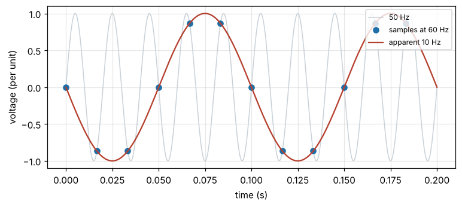
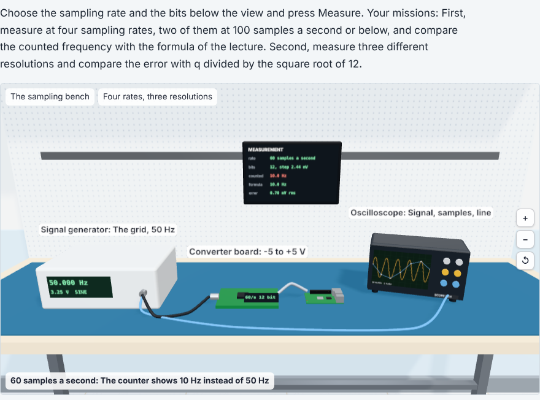

# Week 04: Sensors and Actuators: Sampling, Quantisation, Noise and Smart Meters

**Cyber-Physical Systems (BIL-435 Siber Fiziksel Sistemler)**  
Prof. Dr. Utku Kose, Süleyman Demirel University

   

How a cyber-physical system turns physical quantities into numbers, and numbers back into physical effects. The week follows the measurement chain from the sensor to the converter and treats calibration, sampling and aliasing, quantisation, noise and filtering. It explains how a smart meter counts energy, and how actuators are limited. Two virtual laboratories in three dimensions (3D), a sampling bench and the meter cabinet of the library, complete the week. **Estimated study time:** 8 to 9 hours.

## Materials of the week

Each material has its own role. Start with the lecture page; the study path below gives the order and the time of each step.

| Material | What it holds | Open |
|---|---|---|
| Lecture page | The concepts of the week, with a 3D scene, an animation, discussion questions, knowledge checks, the development templates, review cards and the references | [Lecture page](https://utkukose.github.io/cyber-physical-systems-NB-lecture/weeks/week-04/lecture.html) |
| Colab notebook | Python step 4: Signals as arrays, then six hands-on sections that calibrate a sensor, sample and quantise the voltage of the grid, filter the frequency reading, turn the pulses of a meter into power and compute stage 4 of the campus microgrid, with exercises |  |
| Interactive lab | Sensors and actuators lab: Four parts, among them two 3D virtual laboratories (the sampling bench and the meter cabinet of the library), a step-by-step calculator, a self-assessment and an exportable learning log | [Interactive lab](https://utkukose.github.io/cyber-physical-systems-NB-lecture/weeks/week-04/lab.html) |
| PDF lecture notes | The Python step and the lecture in one printable file | [PDF notes](Week04_Lecture_Notes.pdf) |

<table><tr><td width="50%"> From the Colab notebook</td><td width="50%"> The interactive lab</td></tr></table>

## Learning outcomes

By the end of the week, students are expected to describe the chain from a physical quantity to a digital value and to calibrate a sensor at two points. They should be able to choose a sampling rate that avoids aliasing and to compute the apparent frequency of a signal that is sampled too slowly. They should also compute the step and the error of a converter and the noise and the delay of a moving average. Finally, they should be able to turn the pulses of a meter into power and to explain what interval data hide. In Python, students are expected to sample, quantise and filter signals as NumPy arrays.

## Study path

| Step | Activity | Suggested time |
|---|---|---|
| 1 | Read the [lecture page](https://utkukose.github.io/cyber-physical-systems-NB-lecture/weeks/week-04/lecture.html), answer its knowledge checks and think through its discussion questions | 1 hour 45 minutes |
| 2 | Run Python step 4: Signals as arrays in the [Colab notebook](https://colab.research.google.com/github/utkukose/cyber-physical-systems-NB-lecture/blob/main/weeks/week-04/NB04_sensors_actuators.ipynb#scrollTo=python-step), right after the setup section | 1 hour |
| 3 | Work through the two virtual laboratories of the [interactive lab](https://utkukose.github.io/cyber-physical-systems-NB-lecture/weeks/week-04/lab.html), Parts A and C, and solve Parts B and D | 1 hour 30 minutes |
| 4 | Work through Sections 1 to 5 of the Colab notebook with your own results and solve the exercises | 2 hours |
| 5 | Run one development template of the week and use the application switch of Section 6 | 45 minutes |
| 6 | Take the self-assessment in the [interactive lab](https://utkukose.github.io/cyber-physical-systems-NB-lecture/weeks/week-04/lab.html) (tab: Check yourself) | 20 minutes |
| 7 | Write the reflection in the interactive lab, export the learning log and complete the weekly task below | 45 minutes |

## Live session plan

The week runs as one synchronous session of about three hours in class or online, and each material has one role in it. The lecture page is on the screen. At each orange Colab box, the instructor shows the matching section in a copy of the Colab notebook that has already been run. Students work in their own copy from top to bottom, and each part of the interactive lab follows the part of the lecture that it practises. The PDF lecture notes serve reading after the session, and the study path above serves self-paced study.

| Time | Activity |
|---|---|
| 0:00 to 0:15 | Opening: The campus microgrid so far and the question of the week, how well the campus can be measured. Students open the Colab notebook, save a copy in Drive and run Section 0 |
| 0:15 to 0:35 | Colab, together: Python step 4, ending with a moving average of a noisy signal |
| 0:35 to 1:00 | Lecture page, part 1: Sensors and calibration with the 3D scene Inside the smart meter and Section 1 |
| 1:00 to 1:30 | Lecture page, part 2: Sampling with the animation, the sampling bench of Part A and Section 2 |
| 1:30 to 1:40 | Break |
| 1:40 to 2:05 | Lecture page, part 3: Quantisation and noise, the calculator of Part B and Section 3 |
| 2:05 to 2:35 | Lecture page, part 4: Smart meters, the meter cabinet of Part C and Section 4, then the actuators |
| 2:35 to 3:00 | The development templates and the engineering side, the campus microgrid, stage 4 with Part D and Section 5, and the closing section on learning from the meter. After the session: Section 6, the self-assessment, the PDF notes and the weekly task |

## Weekly task and submission

**What to do.** First, choose a sensor that you can read, such as the light sensor or the accelerometer of a phone, or a meter at home. Second, record a signal at two different sampling rates and explain what changes. Third, estimate the noise of the sensor from a still recording and choose a moving average for a target noise, with its delay. Finally, describe one fault of the sensor and a plausibility check that would catch it.

**Where to look.** Lecture: Sections "Sampling: How often to look" and "Quantisation and noise: How finely to look". Interactive lab: Parts A and B. Colab notebook: Sections 2, 3 and 6, and Exercises B and C.

**Example.** A student records the accelerometer of a phone lying on a table, 100 times a second, and finds a noise of 0.012 m/s². A moving average of 9 readings brings it down to 0.004 m/s² with a delay of 40 ms.

**What to submit.** A report of about two pages with the recordings and the comparison of the sampling rates. The report also gives the noise before and after the filter with its delay, and the fault with its check. Add the Colab notebook with the exercises of Week 4 completed.

The task is optional and supports self-learning and a personal portfolio. During an active semester, the items listed under What to submit can be sent together with the learning log exported from the interactive lab to utkukose@sdu.edu.tr or utkukose@gmail.com.

## Research and report assignment (optional)

**Non-intrusive load monitoring** How well can the appliances of a building be recovered from a single meter, and how does its sampling rate limit this?

**What to do.** Select eight studies published since 2015 on non-intrusive load monitoring. For each study, note the data set, the sampling rate of the measurements, the method and the accuracy that it reports. Compare methods that work on interval data with those that need data at a high rate. Then discuss what the results mean for the privacy of the users of smart meters.

**Where to start.** Lecture: Sections "Smart meters: Energy in intervals" and "Learning from the meter". The study of Hart in the references gives a first entry to the literature.

**Example focus.** A study may compare the same method on data of one second and of one minute. Note which appliances it still recognises at the lower rate.

The report should be about 1500 words with at least 8 sources, written in the [report template](../../exams/REPORT_TEMPLATE.docx). During an active semester, it can be sent to utkukose@sdu.edu.tr or utkukose@gmail.com.
