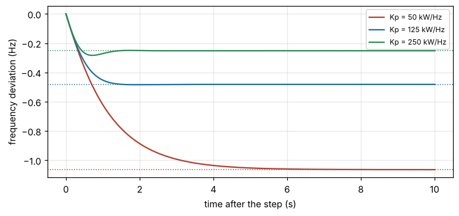
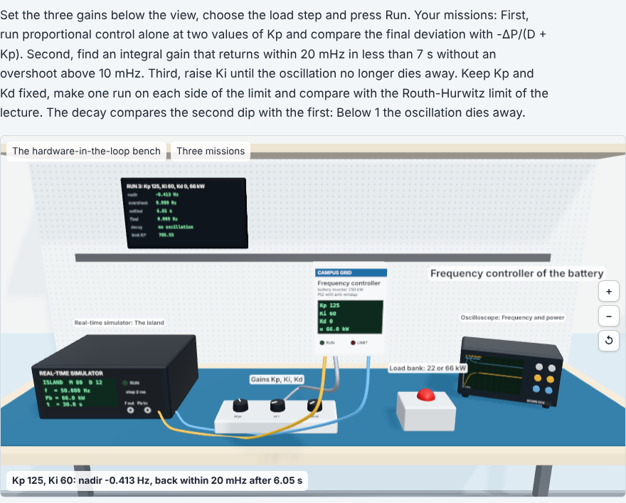

# Week 05: Feedback Control: P, PI and PID, Stability and Frequency Control

**Cyber-Physical Systems (BIL-435 Siber Fiziksel Sistemler)**  
Prof. Dr. Utku Kose, Süleyman Demirel University

   

How a controller makes a physical quantity follow its set point, and how far it may go. The week turns the droop of the battery into a proportional-integral-derivative (PID) controller that returns the island to 50 Hz. It treats the remaining error of proportional control, integral and derivative action, stability with the Routh-Hurwitz criterion, noise, saturation and windup. Two virtual laboratories in three dimensions (3D), a hardware-in-the-loop bench and the inverter cabinet of the battery, complete the week. **Estimated study time:** 8 to 9 hours.

## Materials of the week

Each material has its own role. Start with the lecture page; the study path below gives the order and the time of each step.

| Material | What it holds | Open |
|---|---|---|
| Lecture page | The concepts of the week, with a 3D scene, an animation, discussion questions, knowledge checks, the development templates, review cards and the references | [Lecture page](https://utkukose.github.io/cyber-physical-systems-NB-lecture/weeks/week-05/lecture.html) |
| Colab notebook | Python step 5: Functions for controllers, then six hands-on sections that simulate P, PI and PID control of the island, find the poles and the stability limit, measure the noise of the derivative, test the anti-windup and compute stage 5 of the campus microgrid, with exercises |  |
| Interactive lab | Feedback control lab: Five parts, among them two 3D virtual laboratories (the hardware-in-the-loop bench and the inverter cabinet of the battery), a field task with the settings of the battery inverter, a step-by-step calculator, a self-assessment and an exportable learning log | [Interactive lab](https://utkukose.github.io/cyber-physical-systems-NB-lecture/weeks/week-05/lab.html) |
| PDF lecture notes | The Python step and the lecture in one printable file | [PDF notes](Week05_Lecture_Notes.pdf) |

<table><tr><td width="50%"> From the Colab notebook</td><td width="50%"> The interactive lab</td></tr></table>

## Learning outcomes

By the end of the week, students are expected to describe a feedback loop with its error, its controller and its plant. They should be able to compute the remaining error of proportional control and the natural angular frequency and the damping ratio of proportional-integral (PI) control. They should also apply the Routh-Hurwitz criterion to find the stability limit of the integral gain. Finally, they should be able to explain the noise of a derivative term and the windup of an integral at the limit of an actuator. In Python, students are expected to write controllers as functions and closures and to test them in a simulation loop.

## Study path

| Step | Activity | Suggested time |
|---|---|---|
| 1 | Read the [lecture page](https://utkukose.github.io/cyber-physical-systems-NB-lecture/weeks/week-05/lecture.html), answer its knowledge checks and think through its discussion questions | 1 hour 45 minutes |
| 2 | Run Python step 5: Functions for controllers in the [Colab notebook](https://colab.research.google.com/github/utkukose/cyber-physical-systems-NB-lecture/blob/main/weeks/week-05/NB05_feedback_control.ipynb#scrollTo=python-step), right after the setup section | 1 hour |
| 3 | Work through the two virtual laboratories of the [interactive lab](https://utkukose.github.io/cyber-physical-systems-NB-lecture/weeks/week-05/lab.html), Parts A and C, and solve Parts B and D | 1 hour 30 minutes |
| 4 | Work through Sections 1 to 5 of the Colab notebook with your own results and solve the exercises | 2 hours |
| 5 | Run one development template of the week and use the application switch of Section 6 | 45 minutes |
| 6 | Do the field task of Part E in the [interactive lab](https://utkukose.github.io/cyber-physical-systems-NB-lecture/weeks/week-05/lab.html): Enter the controller of stage 5 into the battery inverter | 30 minutes |
| 7 | Take the self-assessment in the [interactive lab](https://utkukose.github.io/cyber-physical-systems-NB-lecture/weeks/week-05/lab.html) (tab: Check yourself) | 20 minutes |
| 8 | Write the reflection in the interactive lab, export the learning log and complete the weekly task below | 45 minutes |

## Live session plan

The week runs as one synchronous session of about three hours in class or online, and each material has one role in it. The lecture page is on the screen. At each orange Colab box, the instructor shows the matching section in a copy of the Colab notebook that has already been run. Students work in their own copy from top to bottom, and each part of the interactive lab follows the part of the lecture that it practises. The PDF lecture notes serve reading after the session, and the study path above serves self-paced study.

| Time | Activity |
|---|---|
| 0:00 to 0:15 | Opening: The campus microgrid so far and the question of the week, how the battery can bring the island back to 50 Hz. Students open the Colab notebook, save a copy in Drive and run Section 0 |
| 0:15 to 0:35 | Colab, together: Python step 5, ending with a step response of a P controller |
| 0:35 to 1:00 | Lecture page, part 1: Feedback and proportional control with the 3D scene The three terms of the controller and Section 1 |
| 1:00 to 1:30 | Lecture page, part 2: Integral action, the hardware-in-the-loop bench of Part A and Section 2 |
| 1:30 to 1:40 | Break |
| 1:40 to 2:05 | Lecture page, part 3: Stability with the animation, the calculator of Part B and Section 3, then the derivative action |
| 2:05 to 2:35 | Lecture page, part 4: Saturation and windup, the inverter cabinet of Part C and Section 4 |
| 2:35 to 3:00 | The development templates and the engineering side, the campus microgrid, stage 5 with Part D and Section 5, and the closing section on learning to control. After the session: Section 6, the field task of Part E, the self-assessment, the PDF notes and the weekly task |

## Weekly task and submission

**What to do.** First, choose a feedback loop that you can observe, such as the cruise control of a car or the thermostat of a room. Second, describe its sensor, its controller and its actuator, and say whether it leaves a remaining error. Third, simulate P and PI control for it with the application switch of Section 6, using your own estimates of its numbers. Finally, describe what happens at the limit of its actuator and how an anti-windup would help.

**Where to look.** Lecture: Sections "Feedback: Proportional control and its error", "Integral action: Back to 50 Hz" and "Saturation and windup". Interactive lab: Parts A and C. Colab notebook: Sections 1, 2, 4 and 6, and Exercises A, B and D.

**Example.** A student models the cruise control of a car with a time constant of 30 s. P control alone leaves a fifth of a step of 5 m/s as an error, and PI control reaches the set speed within 28 s.

**What to submit.** A report of about two pages with the loop, the simulations and the discussion of the limit. Add the Colab notebook with the exercises of Week 5 completed.

The task is optional and supports self-learning and a personal portfolio. During an active semester, the items listed under What to submit can be sent together with the learning log exported from the interactive lab to utkukose@sdu.edu.tr or utkukose@gmail.com.

## Research and report assignment (optional)

**Learning-based frequency control** Can controllers learned from data control the frequency of an island better than a tuned PID controller, and how is their stability ensured?

**What to do.** Select eight studies published since 2015 on learning-based frequency control of microgrids or power systems. For each study, note the system, the learning method, the baseline controller and how the study argues for stability or safety. Then discuss which results would carry over to the campus microgrid.

**Where to start.** Lecture: Sections "Stability: How far the integral may go" and "Learning to control". The survey of Recht in the references gives a first entry to the literature.

**Example focus.** A study may compare a learned controller with a PID controller on the model of an island and report the nadir. Note whether it also tests the learned controller outside the conditions of its training.

The report should be about 1500 words with at least 8 sources, written in the [report template](../../exams/REPORT_TEMPLATE.docx). During an active semester, it can be sent to utkukose@sdu.edu.tr or utkukose@gmail.com.
