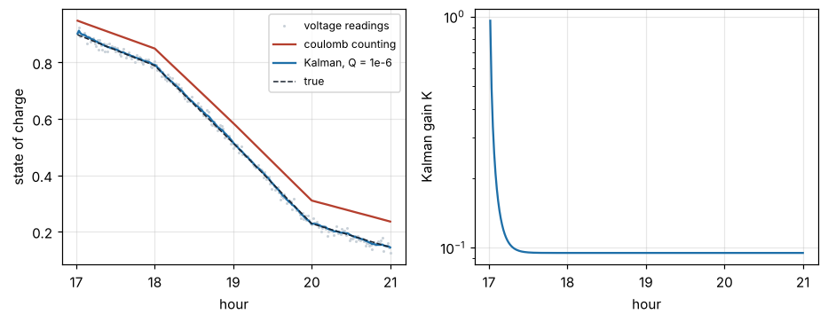
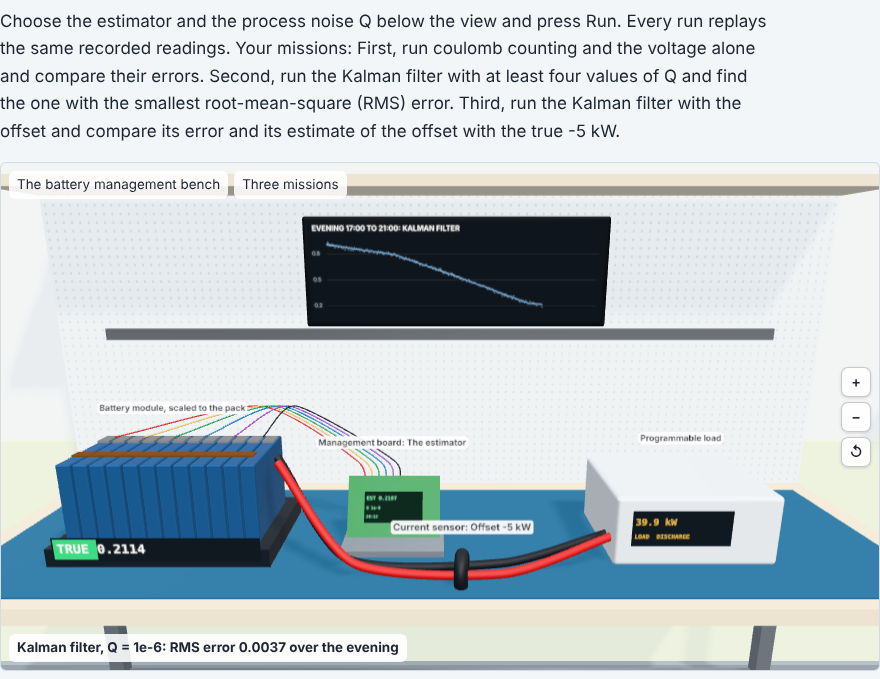

# Week 06: Estimation and Filtering: The Kalman Filter, State Estimation and Bad Data

**Cyber-Physical Systems (BIL-435 Siber Fiziksel Sistemler)**  
Prof. Dr. Utku Kose, Süleyman Demirel University

   

How a cyber-physical system knows the quantities that it cannot measure directly. The week combines noisy measurements by their uncertainty and tracks the state of charge of the battery with the Kalman filter. A filter in matrix form learns the offset of a current sensor. It estimates the feeders of the campus from thirteen meters by weighted least squares and finds a faulty meter with the chi-square test. Two virtual laboratories in three dimensions (3D), a battery management bench and the control room of the campus, complete the week. **Estimated study time:** 8 to 9 hours.

## Materials of the week

Each material has its own role. Start with the lecture page; the study path below gives the order and the time of each step.

| Material | What it holds | Open |
|---|---|---|
| Lecture page | The concepts of the week, with a 3D scene, an animation, discussion questions, knowledge checks, the development templates, review cards and the references | [Lecture page](https://utkukose.github.io/cyber-physical-systems-NB-lecture/weeks/week-06/lecture.html) |
| Colab notebook | Python step 6: Matrices and the Kalman filter, then six hands-on sections that combine sensors, filter the state of charge of the battery, estimate the offset of its current sensor, estimate the feeders of the campus with bad data and compute stage 6 of the campus microgrid, with exercises |  |
| Interactive lab | Estimation lab: Five parts, among them two 3D virtual laboratories (the battery management bench and the control room of the campus), a field task with the zero calibration of the battery management system, a step-by-step calculator, a self-assessment and an exportable learning log | [Interactive lab](https://utkukose.github.io/cyber-physical-systems-NB-lecture/weeks/week-06/lab.html) |
| PDF lecture notes | The Python step and the lecture in one printable file | [PDF notes](Week06_Lecture_Notes.pdf) |

<table><tr><td width="50%"> From the Colab notebook</td><td width="50%"> The interactive lab</td></tr></table>

## Learning outcomes

By the end of the week, students are expected to combine noisy measurements by their uncertainty and to explain why the result is better than each measurement. They should be able to run a Kalman filter by hand for one step and to explain the roles of Q and R. They should also add a constant such as the offset of a sensor to the state of a filter in matrix form. Finally, they should be able to estimate the state of a network by weighted least squares and to detect and identify bad data with the chi-square test. In Python, students are expected to work with vectors and matrices and to write a filter loop.

## Study path

| Step | Activity | Suggested time |
|---|---|---|
| 1 | Read the [lecture page](https://utkukose.github.io/cyber-physical-systems-NB-lecture/weeks/week-06/lecture.html), answer its knowledge checks and think through its discussion questions | 1 hour 45 minutes |
| 2 | Run Python step 6: Matrices and the Kalman filter in the [Colab notebook](https://colab.research.google.com/github/utkukose/cyber-physical-systems-NB-lecture/blob/main/weeks/week-06/NB06_estimation_filtering.ipynb#scrollTo=python-step), right after the setup section | 1 hour |
| 3 | Work through the two virtual laboratories of the [interactive lab](https://utkukose.github.io/cyber-physical-systems-NB-lecture/weeks/week-06/lab.html), Parts A and C, and solve Parts B and D | 1 hour 30 minutes |
| 4 | Work through Sections 1 to 5 of the Colab notebook with your own results and solve the exercises | 2 hours |
| 5 | Run one development template of the week and use the application switch of Section 6 | 45 minutes |
| 6 | Do the field task of Part E in the [interactive lab](https://utkukose.github.io/cyber-physical-systems-NB-lecture/weeks/week-06/lab.html): Calibrate the zero of the current sensor | 30 minutes |
| 7 | Take the self-assessment in the [interactive lab](https://utkukose.github.io/cyber-physical-systems-NB-lecture/weeks/week-06/lab.html) (tab: Check yourself) | 20 minutes |
| 8 | Write the reflection in the interactive lab, export the learning log and complete the weekly task below | 45 minutes |

## Live session plan

The week runs as one synchronous session of about three hours in class or online, and each material has one role in it. The lecture page is on the screen. At each orange Colab box, the instructor shows the matching section in a copy of the Colab notebook that has already been run. Students work in their own copy from top to bottom, and each part of the interactive lab follows the part of the lecture that it practises. The PDF lecture notes serve reading after the session, and the study path above serves self-paced study.

| Time | Activity |
|---|---|
| 0:00 to 0:15 | Opening: The campus microgrid so far and the question of the week, how the campus can know what it cannot measure. Students open the Colab notebook, save a copy in Drive and run Section 0 |
| 0:15 to 0:35 | Colab, together: Python step 6, ending with the running mean |
| 0:35 to 0:55 | Lecture page, part 1: Combining noisy measurements and Section 1 |
| 0:55 to 1:30 | Lecture page, part 2: The Kalman filter with the 3D scene The Kalman filter as a balance, the animation, the battery management bench of Part A and Section 2 |
| 1:30 to 1:40 | Break |
| 1:40 to 2:00 | Lecture page, part 3: The Kalman filter with matrices, the calculator of Part B and Section 3 |
| 2:00 to 2:35 | Lecture page, part 4: State estimation and bad data, the control room of Part C and Section 4 |
| 2:35 to 3:00 | The development templates and the engineering side, the campus microgrid, stage 6 with Part D and Section 5, and the closing section on learning to estimate. After the session: Section 6, the field task of Part E, the self-assessment, the PDF notes and the weekly task |

## Weekly task and submission

**What to do.** First, choose a quantity that two different sensors of your phone or your home can measure, such as the altitude from the barometer and from satellite navigation. Second, record both for a few minutes and estimate the noise of each from a quiet stretch. Third, combine them with a Kalman filter and compare the result with each sensor. Finally, describe one fault of a sensor that your filter would not notice.

**Where to look.** Lecture: Sections "Estimation: Combining noisy measurements" and "The Kalman filter: Predict and correct". Interactive lab: Parts A and B. Colab notebook: Sections 1, 2 and 6, and Exercises A and B.

**Example.** A student records the altitude of a phone on a table. The barometer gives a noise of 0.4 m, satellite navigation 6 m, and the filtered altitude stays within 0.3 m of its mean.

**What to submit.** A report of about two pages with the recordings, the noise of both sensors, the filtered result and the fault. Add the Colab notebook with the exercises of Week 6 completed.

The task is optional and supports self-learning and a personal portfolio. During an active semester, the items listed under What to submit can be sent together with the learning log exported from the interactive lab to utkukose@sdu.edu.tr or utkukose@gmail.com.

## Research and report assignment (optional)

**Estimating the state of charge of batteries** How accurately can the state of charge of a lithium-ion battery be estimated in operation, and what limits the accuracy?

**What to do.** Select eight studies published since 2015 on the estimation of the state of charge of lithium-ion batteries. For each study, note the method, the data, the test conditions and the error that it reports. Compare filters based on models with methods that learn from data. Then discuss which method you would choose for the battery of the campus, and why.

**Where to start.** Lecture: Sections "The Kalman filter: Predict and correct" and "Learning to estimate". The study of Plett in the references gives a first entry to the literature.

**Example focus.** A study may report an error of 1 percent at room temperature and of 3 percent in the cold. Note how the authors measured the true state of charge.

The report should be about 1500 words with at least 8 sources, written in the [report template](../../exams/REPORT_TEMPLATE.docx). During an active semester, it can be sent to utkukose@sdu.edu.tr or utkukose@gmail.com.
