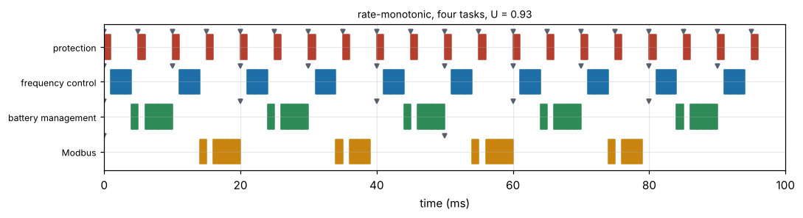
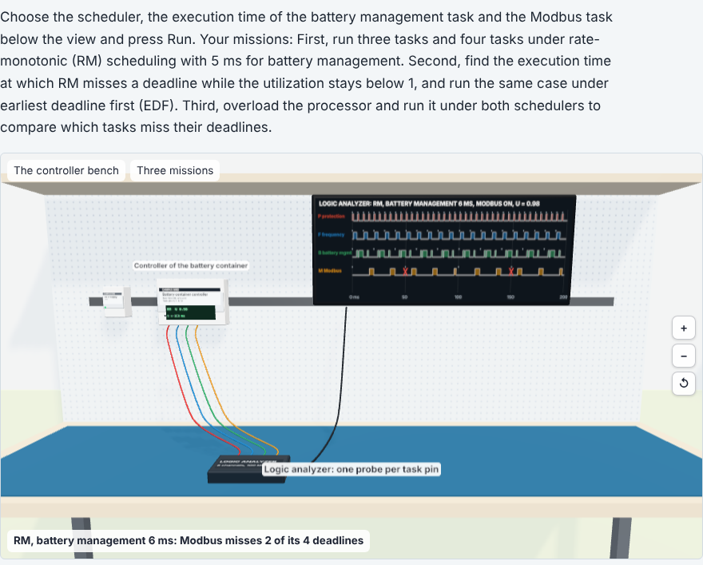

# Week 07: Embedded Computing and Real-Time Scheduling: RM, EDF and the PLC Scan Cycle

**Cyber-Physical Systems (BIL-435 Siber Fiziksel Sistemler)**  
Prof. Dr. Utku Kose, Süleyman Demirel University

   

How the computations of a cyber-physical system finish on time. The week puts the protection, the frequency control, the battery management and the Modbus polling of the campus on one processor. It analyses them with rate-monotonic and earliest-deadline-first scheduling and computes their worst-case response times. It then follows the programmable logic controller (PLC) of the main switchboard through its scan cycle. Two virtual laboratories in three dimensions (3D), a controller bench with a logic analyzer and the PLC cabinet of the main switchboard, complete the week. **Estimated study time:** 8 to 9 hours.

## Materials of the week

Each material has its own role. Start with the lecture page; the study path below gives the order and the time of each step.

| Material | What it holds | Open |
|---|---|---|
| Lecture page | The concepts of the week, with a 3D scene, an animation, discussion questions, knowledge checks, the development templates, review cards and the references | [Lecture page](https://utkukose.github.io/cyber-physical-systems-NB-lecture/weeks/week-07/lecture.html) |
| Colab notebook | Python step 7: Tasks and time, then six hands-on sections that describe the tasks of the controller, compute their response times under RM, compare RM with EDF, follow the scan cycle of the PLC and compute stage 7 of the campus microgrid, with exercises |  |
| Interactive lab | Real-time lab: Five parts, among them two 3D virtual laboratories (the controller bench with a logic analyzer and the PLC cabinet of the main switchboard), a field task with a program change on the PLC, a step-by-step calculator, a self-assessment and an exportable learning log | [Interactive lab](https://utkukose.github.io/cyber-physical-systems-NB-lecture/weeks/week-07/lab.html) |
| PDF lecture notes | The Python step and the lecture in one printable file | [PDF notes](Week07_Lecture_Notes.pdf) |

<table><tr><td width="50%"> From the Colab notebook</td><td width="50%"> The interactive lab</td></tr></table>

## Learning outcomes

By the end of the week, students are expected to describe periodic tasks by their periods and execution times and to compute their utilization. They should be able to test a set of tasks with the bound of Liu and Layland and with the response-time analysis under rate-monotonic priorities. They should also compare rate-monotonic and earliest-deadline-first scheduling, below the limit and in an overload. Finally, they should be able to compute the reaction time of a PLC from its scan time. In Python, students are expected to write a class, to sort objects by a key and to write a scheduler loop.

## Study path

| Step | Activity | Suggested time |
|---|---|---|
| 1 | Read the [lecture page](https://utkukose.github.io/cyber-physical-systems-NB-lecture/weeks/week-07/lecture.html), answer its knowledge checks and think through its discussion questions | 1 hour 45 minutes |
| 2 | Run Python step 7: Tasks and time in the [Colab notebook](https://colab.research.google.com/github/utkukose/cyber-physical-systems-NB-lecture/blob/main/weeks/week-07/NB07_realtime_scheduling.ipynb#scrollTo=python-step), right after the setup section | 1 hour |
| 3 | Work through the two virtual laboratories of the [interactive lab](https://utkukose.github.io/cyber-physical-systems-NB-lecture/weeks/week-07/lab.html), Parts A and C, and solve Parts B and D | 1 hour 30 minutes |
| 4 | Work through Sections 1 to 5 of the Colab notebook with your own results and solve the exercises | 2 hours |
| 5 | Run one development template of the week and use the application switch of Section 6 | 45 minutes |
| 6 | Do the field task of Part E in the [interactive lab](https://utkukose.github.io/cyber-physical-systems-NB-lecture/weeks/week-07/lab.html): Change and test the program of the PLC | 30 minutes |
| 7 | Take the self-assessment in the [interactive lab](https://utkukose.github.io/cyber-physical-systems-NB-lecture/weeks/week-07/lab.html) (tab: Check yourself) | 20 minutes |
| 8 | Write the reflection in the interactive lab, export the learning log and complete the weekly task below | 45 minutes |

## Live session plan

The week runs as one synchronous session of about three hours in class or online, and each material has one role in it. The lecture page is on the screen. At each orange Colab box, the instructor shows the matching section in a copy of the Colab notebook that has already been run. Students work in their own copy from top to bottom, and each part of the interactive lab follows the part of the lecture that it practises. The PDF lecture notes serve reading after the session, and the study path above serves self-paced study.

| Time | Activity |
|---|---|
| 0:00 to 0:15 | Opening: The campus microgrid so far and the question of the week, whether the computations of the campus finish in time. Students open the Colab notebook, save a copy in Drive and run Section 0 |
| 0:15 to 0:35 | Colab, together: Python step 7, ending with the scheduler loop |
| 0:35 to 0:55 | Lecture page, part 1: Tasks on one processor and Section 1 |
| 0:55 to 1:30 | Lecture page, part 2: Rate-monotonic scheduling with the 3D scene One processor, four tasks, and Section 2 |
| 1:30 to 1:40 | Break |
| 1:40 to 2:10 | Lecture page, part 3: Earliest deadline first, the controller bench of Part A, the calculator of Part B and Section 3 |
| 2:10 to 2:40 | Lecture page, part 4: The PLC scan cycle with the animation, the PLC cabinet of Part C and Section 4 |
| 2:40 to 3:00 | The development templates and the engineering side, the campus microgrid, stage 7 with Part D and Section 5, and the closing section on learning to schedule. After the session: Section 6, the field task of Part E, the self-assessment, the PDF notes and the weekly task |

## Weekly task and submission

**What to do.** First, choose a device with several periodic duties, such as a smart watch, a drone or a washing machine. Second, list four of its tasks with a plausible period and execution time, and justify each value. Third, compute the utilization and the response times under rate-monotonic (RM) scheduling, and check them with the simulator of Section 2. Finally, describe what the device should do in an overload.

**Where to look.** Lecture: Sections "Tasks on one processor", "Rate-monotonic scheduling" and "Earliest deadline first". Interactive lab: Parts A and B. Colab notebook: Sections 1 to 3 and 6, and Exercises A to C.

**Example.** A student lists four tasks of a smart watch: The heart-rate sensor needs 1 ms every 20 ms and the display 8 ms every 50 ms. The step counter needs 2 ms every 100 ms and the radio 15 ms every 200 ms. The utilization is 0.31, and every task meets its deadline under RM.

**What to submit.** A report of about two pages with the tasks, the analysis, the simulated schedule and the plan for an overload. Add the Colab notebook with the exercises of Week 7 completed.

The task is optional and supports self-learning and a personal portfolio. During an active semester, the items listed under What to submit can be sent together with the learning log exported from the interactive lab to utkukose@sdu.edu.tr or utkukose@gmail.com.

## Research and report assignment (optional)

**Mixed criticality on one processor** How can tasks of different importance share one processor without endangering the critical ones?

**What to do.** Select eight studies published since 2010 on mixed-criticality scheduling or on the isolation of tasks in embedded systems. For each study, note the model of the tasks, the scheduling method, the guarantee that it gives and the evaluation. Compare methods that use priorities with methods that use time partitions. Then discuss which method you would choose for the controller of the battery container, and why.

**Where to start.** Lecture: Sections "Rate-monotonic scheduling", "Earliest deadline first" and "The engineering side: Timing that holds". The book of Buttazzo in the references gives a first entry to the literature.

**Example focus.** A study may give the critical tasks a guarantee for a pessimistic execution time and drop the other tasks when that time is reached. Note how the authors check that the critical tasks are safe.

The report should be about 1500 words with at least 8 sources, written in the [report template](../../exams/REPORT_TEMPLATE.docx). During an active semester, it can be sent to utkukose@sdu.edu.tr or utkukose@gmail.com.
