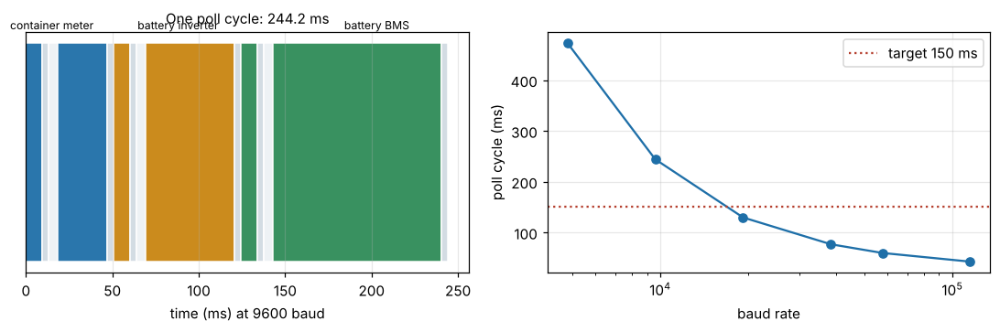
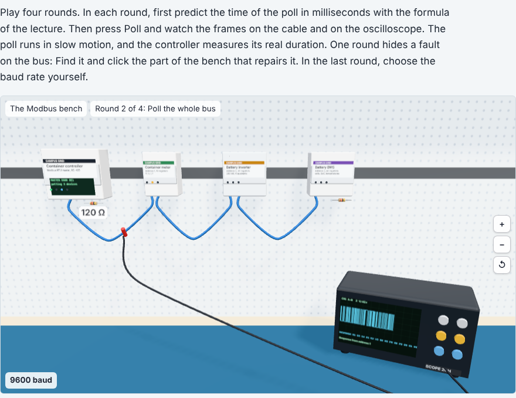

# Week 08: Networks and Communication: Modbus, MQTT, IEC 61850 and Control over Networks

**Cyber-Physical Systems (BIL-435 Siber Fiziksel Sistemler)**  
Prof. Dr. Utku Kose, Süleyman Demirel University

   

How the devices of a cyber-physical system exchange data. The week covers the delays on a link, polling over a Modbus fieldbus, publish and subscribe with MQTT and the fast trip messages of IEC 61850. It continues with queues and with the delay margin of a control loop that runs over a network. Three virtual laboratories in three dimensions (3D) with the hardware in the foreground complete the week. **Estimated study time:** 8 to 9 hours.

## Materials of the week

Each material has its own role. Start with the lecture page; the study path below gives the order and the time of each step.

| Material | What it holds | Open |
|---|---|---|
| Lecture page | The concepts of the week, with a 3D scene, an animation, discussion questions, knowledge checks, the development templates, review cards and the references | [Lecture page](https://utkukose.github.io/cyber-physical-systems-NB-lecture/weeks/week-08/lecture.html) |
| Colab notebook | Python step 8: Bytes, bits and binary messages, then six hands-on sections that build Modbus frames with their CRC and poll cycles, match MQTT topics and count the traffic, compute repeated trip messages and simulate a queue, run the frequency loop through a delayed network and compute stage 8 of the campus microgrid, with exercises |  |
| Interactive lab | Networks and communication lab: Four parts, among them three 3D virtual laboratories (the Modbus bench, the MQTT broker and frequency control over the network), step-by-step calculators, a self-assessment and an exportable learning log | [Interactive lab](https://utkukose.github.io/cyber-physical-systems-NB-lecture/weeks/week-08/lab.html) |
| PDF lecture notes | The Python step and the lecture in one printable file | [PDF notes](Week08_Lecture_Notes.pdf) |

<table><tr><td width="50%"> From the Colab notebook</td><td width="50%"> The interactive lab</td></tr></table>

## Learning outcomes

By the end of the week, students are expected to explain the layers of a network and to compute the four delays of a link. They should be able to build and check Modbus RTU (remote terminal unit) frames and compute the poll cycle of a fieldbus. They should also design MQTT topics and filters with wildcards and count the packets of the levels of quality of service. They should explain the fast messages of IEC 61850 with their repetitions. Finally, they should be able to compute the delays of a queue and the delay margin of a control loop that runs over a network. In Python, students are expected to handle bytes, bits and registers.

## Study path

| Step | Activity | Suggested time |
|---|---|---|
| 1 | Read the [lecture page](https://utkukose.github.io/cyber-physical-systems-NB-lecture/weeks/week-08/lecture.html), answer its knowledge checks and think through its discussion questions | 1 hour 45 minutes |
| 2 | Run Python step 8: Bytes, bits and binary messages in the [Colab notebook](https://colab.research.google.com/github/utkukose/cyber-physical-systems-NB-lecture/blob/main/weeks/week-08/NB08_networks_communication.ipynb#scrollTo=python-step), right after the setup section | 1 hour |
| 3 | Work through the three virtual laboratories of the [interactive lab](https://utkukose.github.io/cyber-physical-systems-NB-lecture/weeks/week-08/lab.html), Parts A, B and C, and solve Part D | 1 hour 30 minutes |
| 4 | Work through Sections 1 to 5 of the Colab notebook with your own results and solve the exercises | 2 hours |
| 5 | Run one development template of the week and use the application switch of Section 6 | 45 minutes |
| 6 | Take the self-assessment in the [interactive lab](https://utkukose.github.io/cyber-physical-systems-NB-lecture/weeks/week-08/lab.html) (tab: Check yourself) | 20 minutes |
| 7 | Write the reflection in the interactive lab, export the learning log and complete the weekly task below | 45 minutes |

## Live session plan

The week runs as one synchronous session of about three hours in class or online, and each material has one role in it. The lecture page is on the screen. At each orange Colab box, the instructor shows the matching section in a copy of the Colab notebook that has already been run. Students work in their own copy from top to bottom, and each part of the interactive lab follows the part of the lecture that it practises. The PDF lecture notes serve reading after the session, and the study path above serves self-paced study.

| Time | Activity |
|---|---|
| 0:00 to 0:15 | Opening: The campus microgrid so far and the question of the week, how its devices exchange data in time. Students open the Colab notebook, save a copy in Drive and run Section 0 |
| 0:15 to 0:35 | Colab, together: Python step 8, ending with a checksum over a frame |
| 0:35 to 1:05 | Lecture page, part 1: Layers and delays, then Modbus with its frames, CRC and poll cycle, the Modbus bench of Part A and Section 1 |
| 1:05 to 1:30 | Lecture page, part 2: MQTT with topics, wildcards and quality of service, the broker of Part B and Section 2 |
| 1:30 to 1:40 | Break |
| 1:40 to 2:05 | Lecture page, part 3: IEC 61850 with the 3D scene A trip in the substation, queues with the animation and Section 3 |
| 2:05 to 2:35 | Lecture page, part 4: Control over a network and the delay margin, the frequency loop of Part C and Section 4 |
| 2:35 to 3:00 | The development templates and the comparison of the protocols, the campus microgrid, stage 8 with Part D and Section 5, and the closing section on the edge and the cloud. After the session: Section 6, the self-assessment, the PDF notes and the weekly task |

## Weekly task and submission

**What to do.** First, choose a small cyber-physical system that you know, such as a heated house, a greenhouse or a parking garage. List its devices with the values each one sends. Second, design its communication: Which values are polled over a fieldbus, which are published to a broker with which topics, and which need fast messages. Third, compute the poll cycle of the fieldbus and the messages per hour of the broker with Sections 1 and 2 of the Colab notebook. Finally, choose one control loop of the system, estimate its constants $a$ and $b$ and compute its delay margin and the share of it that your design keeps.

**Where to look.** Lecture: Sections "Modbus: Polling the field devices", "MQTT: Publish and subscribe" and "Control over a network". Interactive lab: Parts A to C. Colab notebook: Sections 1, 2 and 4, and Exercises A, B and D.

**Example.** A student designs a greenhouse with six sensors of eight registers each on an RS-485 bus at 9600 baud, a poll cycle of 277.5 ms, and eight values published every minute, 480 messages per hour. The heating loop with $a = 0.002$ and $b = 0.01$ has a delay margin of 180.9 s, so a loop delay of 5 s keeps 97 percent of it.

**What to submit.** A report of about two pages with the list of devices, the communication design with its topics, the computed poll cycle, traffic and delay margin, and a short discussion. Add the Colab notebook with the exercises of Week 8 completed.

The task is optional and supports self-learning and a personal portfolio. During an active semester, the items listed under What to submit can be sent together with the learning log exported from the interactive lab to utkukose@sdu.edu.tr or utkukose@gmail.com.

## Research and report assignment (optional)

**Networked control in power systems** How do communication delays and packet losses affect the control of power systems and microgrids, and which methods make the control robust against them?

**What to do.** Select eight studies published since 2010 on control with communication delays in power systems, such as load frequency control, wide-area damping control or the secondary control of microgrids. For each study, note the system, the delays or losses considered, the method that copes with them and how the method was evaluated. Compare the findings with the delay margin of the lecture. Then discuss which control functions should stay local and which may rely on a network.

**Where to start.** Lecture: Sections "Latency, queues and repetition" and "Control over a network". The references of the lecture page, in particular the survey of networked control systems, give a first entry to the literature.

**Example focus.** A study may model the delay of a load frequency control loop and compute its delay margin for several gains. Note how much margin the proposed method gains and at which cost.

The report should be about 1500 words with at least 8 sources, written in the [report template](../../exams/REPORT_TEMPLATE.docx). During an active semester, it can be sent to utkukose@sdu.edu.tr or utkukose@gmail.com.
