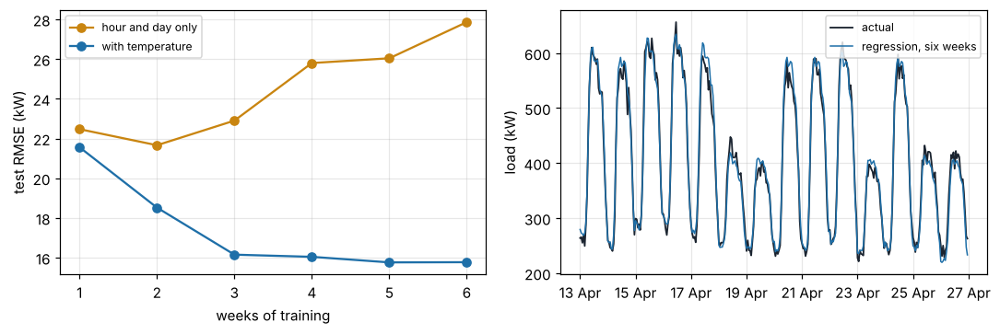
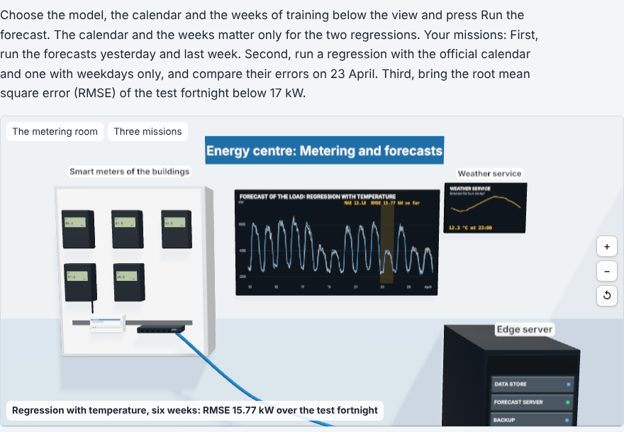

# Week 10: Learning from Data: Load and Generation Forecasting, Anomaly Detection

**Cyber-Physical Systems (BIL-435 Siber Fiziksel Sistemler)**  
Prof. Dr. Utku Kose, Süleyman Demirel University

   

How a cyber-physical system learns from its own measurements. The week treats eight weeks of hourly data of the campus as a time series and measures the errors of simple forecasts. It forecasts the load with a linear regression on the hour, the type of day and the temperature, and the solar plant with the cloud forecast of the weather service. It then finds the faults of the solar plant in the residual of its model. Two virtual laboratories in three dimensions (3D), the metering room and the solar plant of the campus, complete the week. **Estimated study time:** 8 to 9 hours.

## Materials of the week

Each material has its own role. Start with the lecture page; the study path below gives the order and the time of each step.

| Material | What it holds | Open |
|---|---|---|
| Lecture page | The concepts of the week, with a 3D scene, an animation, discussion questions, knowledge checks, the development templates, review cards and the references | [Lecture page](https://utkukose.github.io/cyber-physical-systems-NB-lecture/weeks/week-10/lecture.html) |
| Colab notebook | Python step 10: Fitting and forecasting, then six hands-on sections that measure forecast errors, learn the load model, forecast the solar plant and the wind turbine, detect the faults of the solar plant and compute stage 10 of the campus microgrid, with exercises |  |
| Interactive lab | Forecasting and anomaly lab: Four parts, among them two 3D virtual laboratories (the metering room and the solar plant of the campus), a step-by-step calculator, a self-assessment and an exportable learning log | [Interactive lab](https://utkukose.github.io/cyber-physical-systems-NB-lecture/weeks/week-10/lab.html) |
| PDF lecture notes | The Python step and the lecture in one printable file | [PDF notes](Week10_Lecture_Notes.pdf) |

<table><tr><td width="50%"> From the Colab notebook</td><td width="50%"> The interactive lab</td></tr></table>

## Learning outcomes

By the end of the week, students are expected to split a time series into training and test periods and to compare forecasts with naive ones. They should measure the errors with the mean absolute error (MAE), the root mean square error (RMSE) and the mean absolute percentage error (MAPE). They should also be able to forecast a load by linear regression on the hour, the type of day and the temperature. They should recognise overfitting and forecast the solar plant from a cloud forecast. Finally, they should be able to detect faults in the residual of a model with a threshold and with the cumulative sum (CUSUM). They should judge the detectors by precision and recall. In Python, students are expected to cut and shift time series with pandas and to fit models with `np.linalg.lstsq`.

## Study path

| Step | Activity | Suggested time |
|---|---|---|
| 1 | Read the [lecture page](https://utkukose.github.io/cyber-physical-systems-NB-lecture/weeks/week-10/lecture.html), answer its knowledge checks and think through its discussion questions | 1 hour 45 minutes |
| 2 | Run Python step 10: Fitting and forecasting in the [Colab notebook](https://colab.research.google.com/github/utkukose/cyber-physical-systems-NB-lecture/blob/main/weeks/week-10/NB10_learning_from_data.ipynb#scrollTo=python-step), right after the setup section | 1 hour |
| 3 | Work through the two virtual laboratories of the [interactive lab](https://utkukose.github.io/cyber-physical-systems-NB-lecture/weeks/week-10/lab.html), Parts A and C, and solve Parts B and D | 1 hour 30 minutes |
| 4 | Work through Sections 1 to 5 of the Colab notebook with your own results and solve the exercises | 2 hours |
| 5 | Run one development template of the week and use the application switch of Section 6 | 45 minutes |
| 6 | Take the self-assessment in the [interactive lab](https://utkukose.github.io/cyber-physical-systems-NB-lecture/weeks/week-10/lab.html) (tab: Check yourself) | 20 minutes |
| 7 | Write the reflection in the interactive lab, export the learning log and complete the weekly task below | 45 minutes |

## Live session plan

The week runs as one synchronous session of about three hours in class or online, and each material has one role in it. The lecture page is on the screen. At each orange Colab box, the instructor shows the matching section in a copy of the Colab notebook that has already been run. Students work in their own copy from top to bottom, and each part of the interactive lab follows the part of the lecture that it practises. The PDF lecture notes serve reading after the session, and the study path above serves self-paced study.

| Time | Activity |
|---|---|
| 0:00 to 0:15 | Opening: The campus microgrid so far and the question of the week, how the campus learns its forecasts from data. Students open the Colab notebook, save a copy in Drive and run Section 0 |
| 0:15 to 0:35 | Colab, together: Python step 10, ending with the errors of a forecast |
| 0:35 to 0:55 | Lecture page, part 1: Time series and forecast errors with the animation of three forecasts and Section 1 |
| 0:55 to 1:30 | Lecture page, part 2: Regression with the 3D scene A surface through the data, the metering room of Part A and Section 2 |
| 1:30 to 1:40 | Break |
| 1:40 to 2:05 | Lecture page, part 3: Forecasting the generation, the calculator of Part B and Section 3 |
| 2:05 to 2:40 | Lecture page, part 4: Anomaly detection, the solar plant of Part C and Section 4 |
| 2:40 to 3:00 | The development templates and the engineering side, the campus microgrid, stage 10 with Part D and Section 5, and the closing section on learning machines. After the session: Section 6, the self-assessment, the PDF notes and the weekly task |

## Weekly task and submission

**What to do.** First, choose a quantity that you can observe every hour or every day for at least four weeks. Examples are the visitors of a library, the energy of a household, the queue at a canteen or one series of the application switch. Second, split it by time into training and test periods. Third, forecast the test period with the forecast last week and with a regression on the hour or day and one more feature, and compare the MAE and the RMSE. Finally, flag the observations whose residual exceeds three standard deviations and explain at least one of them.

**Where to look.** Lecture: Sections "Time series and forecast errors", "Regression: Forecasting the load" and "Anomaly detection". Interactive lab: Parts A and C. Colab notebook: Sections 1, 2, 4 and 6, and Exercises A, B and D.

**Example.** A student counts the books lent by a faculty library each day for five weeks. The forecast last week has an MAE of 14 books, and a regression on the weekday and the exam period reaches 9. The largest residual falls on the day of a power cut.

**What to submit.** A report of about two pages with the data, the split, the two forecasts with their errors and the anomalies. Add the Colab notebook with the exercises of Week 10 completed.

The task is optional and supports self-learning and a personal portfolio. During an active semester, the items listed under What to submit can be sent together with the learning log exported from the interactive lab to utkukose@sdu.edu.tr or utkukose@gmail.com.

## Research and report assignment (optional)

**Forecasting and anomaly detection in smart grids** Which methods forecast the load and the generation of microgrids, and how do they detect faults of the equipment from data?

**What to do.** Select eight studies published since 2014 on load or photovoltaic forecasting or on anomaly detection in power systems. For each study, note the data and the method: Regression, time series model, neural network or statistical detector. Note also the horizon or the kind of anomaly and the errors or detection rates that it reports. Compare how the studies split their data into training and test periods. Then discuss which methods you would combine for the campus, and why.

**Where to start.** Lecture: Sections "Regression: Forecasting the load", "Anomaly detection" and "Learning machines for forecasts and anomalies". The reviews of Hong and Fan and of Antonanzas and co-authors in the references give a first entry to the literature.

**Example focus.** A study may report that a neural network lowers the MAPE of a day-ahead load forecast from 4 to 3 percent. Note against which naive forecast it was compared and on how many days.

The report should be about 1500 words with at least 8 sources, written in the [report template](../../exams/REPORT_TEMPLATE.docx). During an active semester, it can be sent to utkukose@sdu.edu.tr or utkukose@gmail.com.
