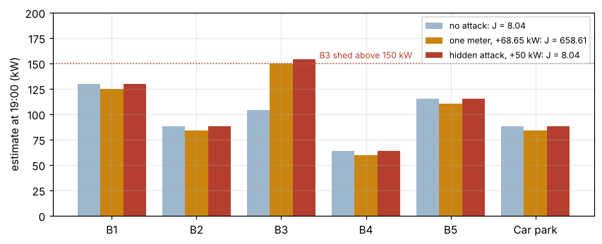
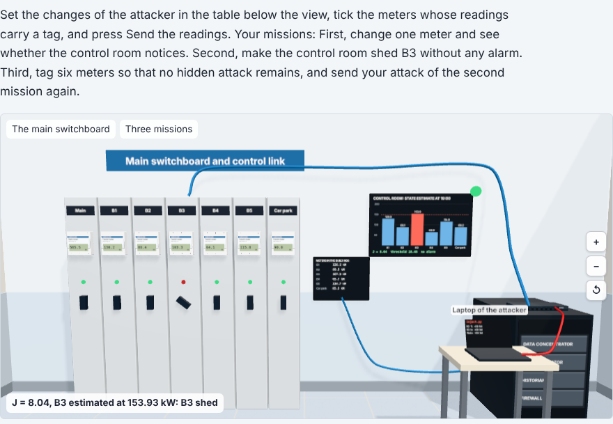

# Week 11: Security of Cyber-Physical Systems: False Data Injection and Defences

**Cyber-Physical Systems (BIL-435 Siber Fiziksel Sistemler)**  
Prof. Dr. Utku Kose, Süleyman Demirel University

   

How an attacker turns the cyber part of a cyber-physical system against its physical part, and how the system defends itself. The week forges a command on the Modbus bus of the battery and hides false data in the state estimate of Week 6. It replays the frequency to the battery controller and detects the replay with a secret watermark. It then protects messages with keyed hashes and counters and chooses the meters that must carry a tag. Two virtual laboratories in three dimensions (3D), the main switchboard and the island controller of the campus, complete the week. **Estimated study time:** 8 to 9 hours.

## Materials of the week

Each material has its own role. Start with the lecture page; the study path below gives the order and the time of each step.

| Material | What it holds | Open |
|---|---|---|
| Lecture page | The concepts of the week, with a 3D scene, an animation, discussion questions, knowledge checks, the development templates, review cards and the references | [Lecture page](https://utkukose.github.io/cyber-physical-systems-NB-lecture/weeks/week-11/lecture.html) |
| Colab notebook | Python step 11: Hashes and keys, then six hands-on sections that forge a command, hide false data in the state estimate, replay the frequency of the island, authenticate frames, choose protected meters and compute stage 11 of the campus microgrid, with exercises |  |
| Interactive lab | Attack and defence lab: Four parts, among them two 3D virtual laboratories (the main switchboard and the island controller of the campus), a step-by-step calculator, a self-assessment and an exportable learning log | [Interactive lab](https://utkukose.github.io/cyber-physical-systems-NB-lecture/weeks/week-11/lab.html) |
| PDF lecture notes | The Python step and the lecture in one printable file | [PDF notes](Week11_Lecture_Notes.pdf) |

<table><tr><td width="50%"> From the Colab notebook</td><td width="50%"> The interactive lab</td></tr></table>

## Learning outcomes

By the end of the week, students are expected to describe the attack surface of a cyber-physical system and its goals of security. They should explain why a checksum does not protect a command. They should also be able to construct a false data injection (FDI) that passes the chi-square test and explain it with the column space of H. They should detect a replay attack on a control loop with a physical watermark. Finally, they should be able to choose protected meters by the rank of their rows of H. They should authenticate messages with a hash-based message authentication code (HMAC) and a counter. In Python, students are expected to compute hashes and keyed hashes with `hashlib` and `hmac` and to test the rank of a matrix with NumPy.

## Study path

| Step | Activity | Suggested time |
|---|---|---|
| 1 | Read the [lecture page](https://utkukose.github.io/cyber-physical-systems-NB-lecture/weeks/week-11/lecture.html), answer its knowledge checks and think through its discussion questions | 1 hour 45 minutes |
| 2 | Run Python step 11: Hashes and keys in the [Colab notebook](https://colab.research.google.com/github/utkukose/cyber-physical-systems-NB-lecture/blob/main/weeks/week-11/NB11_cps_security.ipynb#scrollTo=python-step), right after the setup section | 45 minutes |
| 3 | Work through the two virtual laboratories of the [interactive lab](https://utkukose.github.io/cyber-physical-systems-NB-lecture/weeks/week-11/lab.html), Parts A and C, and solve Parts B and D | 1 hour 30 minutes |
| 4 | Work through Sections 1 to 5 of the Colab notebook with your own results and solve the exercises | 2 hours |
| 5 | Run one development template of the week and use the application switch of Section 6 | 45 minutes |
| 6 | Take the self-assessment in the [interactive lab](https://utkukose.github.io/cyber-physical-systems-NB-lecture/weeks/week-11/lab.html) (tab: Check yourself) | 20 minutes |
| 7 | Write the reflection in the interactive lab, export the learning log and complete the weekly task below | 45 minutes |

## Live session plan

The week runs as one synchronous session of about three hours in class or online, and each material has one role in it. The lecture page is on the screen. At each orange Colab box, the instructor shows the matching section in a copy of the Colab notebook that has already been run. Students work in their own copy from top to bottom, and each part of the interactive lab follows the part of the lecture that it practises. The PDF lecture notes serve reading after the session, and the study path above serves self-paced study.

| Time | Activity |
|---|---|
| 0:00 to 0:15 | Opening: The campus microgrid so far and the question of the week, what happens when the data of the campus cannot be trusted. Students open the Colab notebook, save a copy in Drive and run Section 0 |
| 0:15 to 0:35 | Colab, together: Python step 11, ending with counters against replay |
| 0:35 to 0:55 | Lecture page, part 1: Threats and attack surfaces with the animation of a forged setpoint and Section 1 |
| 0:55 to 1:30 | Lecture page, part 2: False data injection with the 3D scene The plane of consistent readings, the main switchboard of Part A, the calculator of Part B and Section 2 |
| 1:30 to 1:40 | Break |
| 1:40 to 2:15 | Lecture page, part 3: Attacks on control loops, the island controller of Part C and Section 3 |
| 2:15 to 2:40 | Lecture page, part 4: Defences in depth and Section 4 |
| 2:40 to 3:00 | The development templates and the engineering side, the campus microgrid, stage 11 with Part D and Section 5, and the closing section on learning machines. After the session: Section 6, the self-assessment, the PDF notes and the weekly task |

## Weekly task and submission

**What to do.** First, choose a cyber-physical system that you know, such as a building, a vehicle, a water network or one system of the application switch. Second, list its entry points and write a linear model z = Hx of at least three quantities and five meters. Third, build a hidden injection against one quantity and test it with the chi-square test, together with an attack on one meter. Finally, choose the smallest set of protected meters that stops every hidden attack and propose one more defence with its cost.

**Where to look.** Lecture: Sections "Threats and attack surfaces", "False data injection" and "Defences in depth". Interactive lab: Parts A and B. Colab notebook: Sections 2, 4 and 6, and Exercises B and D.

**Example.** A student models the heat meters of three flats and the main heat meter of a house. A hidden attack moves 2 kW from one flat to another without any alarm, which would shift the heating bills. Tagging the meters of two flats and the main meter stops it.

**What to submit.** A report of about two pages with the system, its entry points, the model, the two attacks and the defences. Add the Colab notebook with the exercises of Week 11 completed.

The task is optional and supports self-learning and a personal portfolio. During an active semester, the items listed under What to submit can be sent together with the learning log exported from the interactive lab to utkukose@sdu.edu.tr or utkukose@gmail.com.

## Research and report assignment (optional)

**Attacks on cyber-physical systems and their defences** Which attacks on cyber-physical systems have been studied, and which defences detect or prevent them?

**What to do.** Select eight studies published since 2010 on false data injection, replay or denial-of-service attacks against cyber-physical systems. For each study, note the system and the resources of the attacker: Model knowledge, disclosure and disruption. Note also the defence, such as detection, protection of meters, watermarking or authentication, and how the study evaluates it. Compare the assumptions about the attacker. Then discuss which defences you would combine for the campus, and why.

**Where to start.** Lecture: Sections "False data injection", "Attacks on control loops: Replay and denial of service" and "Defences in depth". The survey of Humayed and co-authors and the framework of Teixeira and co-authors in the references give a first entry to the literature.

**Example focus.** A study may show that a watermark detects a replay within a few seconds on a water tank. Note the size of the watermark, the cost in control performance and whether the attacker could learn the watermark.

The report should be about 1500 words with at least 8 sources, written in the [report template](../../exams/REPORT_TEMPLATE.docx). During an active semester, it can be sent to utkukose@sdu.edu.tr or utkukose@gmail.com.
