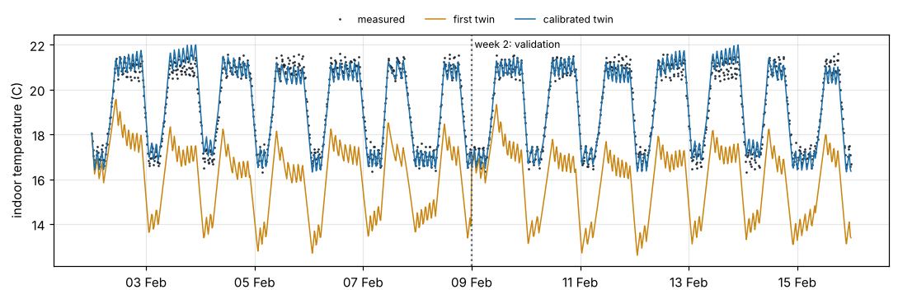
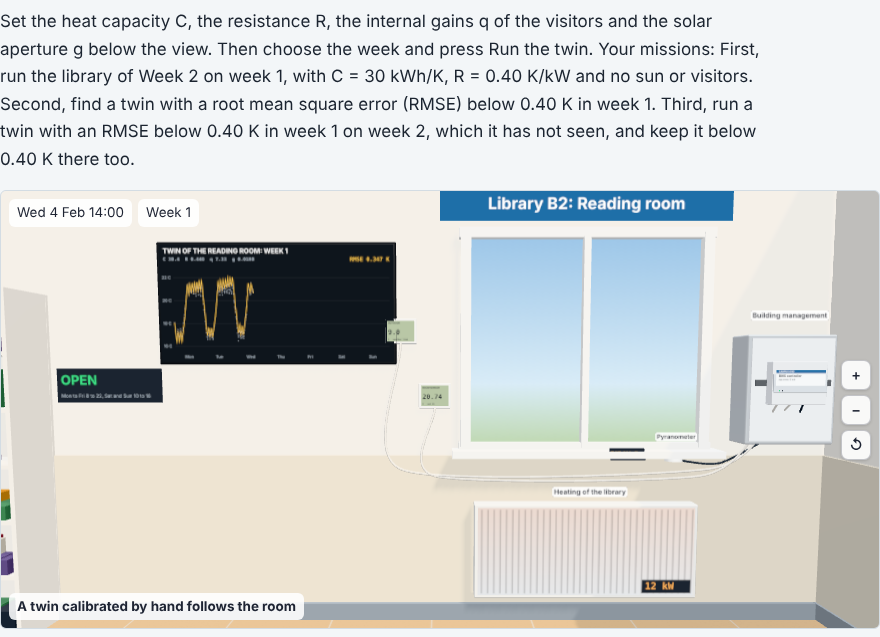

# Week 12: Digital Twins I: Synchronisation and Calibration

**Cyber-Physical Systems (BIL-435 Siber Fiziksel Sistemler)**  
Prof. Dr. Utku Kose, Süleyman Demirel University

   

How a model becomes a digital twin that follows its physical counterpart. The week builds a twin of the library of the campus from three weeks of logged data. It calibrates the parameters of the twin on one week and validates them on another. It synchronises the state of the twin with every measurement and detects a change of the building with a cumulative sum (CUSUM) on the innovations. It then recalibrates the resistance of the building from a sliding window. Two virtual laboratories in three dimensions (3D), the reading room of the library and the operations room of the facility management, complete the week. **Estimated study time:** 8 to 9 hours.

## Materials of the week

Each material has its own role. Start with the lecture page; the study path below gives the order and the time of each step.

| Material | What it holds | Open |
|---|---|---|
| Lecture page | The concepts of the week, with a 3D scene, an animation, discussion questions, knowledge checks, the development templates, review cards and the references | [Lecture page](https://utkukose.github.io/cyber-physical-systems-NB-lecture/weeks/week-12/lecture.html) |
| Colab notebook | Python step 12: A twin as a class, then six hands-on sections that run a first twin of the library, calibrate it by the output error, synchronise it with the measurements, detect an open window, recalibrate the resistance and compute stage 12 of the campus microgrid, with exercises |  |
| Interactive lab | Digital twin lab: Four parts, among them two 3D virtual laboratories (the reading room of the library and the operations room of the facility management), a step-by-step calculator, a self-assessment and an exportable learning log | [Interactive lab](https://utkukose.github.io/cyber-physical-systems-NB-lecture/weeks/week-12/lab.html) |
| PDF lecture notes | The Python step and the lecture in one printable file | [PDF notes](Week12_Lecture_Notes.pdf) |

<table><tr><td width="50%"> From the Colab notebook</td><td width="50%"> The interactive lab</td></tr></table>

## Learning outcomes

By the end of the week, students are expected to distinguish a digital model, a digital shadow and a digital twin. They should calibrate the parameters of a grey-box model by the output error and validate them on separate data. They should also be able to synchronise the state of a twin with measurements and choose the gain of the correction. Finally, they should be able to detect a drift of the physical object with a cumulative sum (CUSUM) on the innovations and recalibrate a parameter from a sliding window. In Python, students are expected to write classes and to fit parameters with SciPy.

## Study path

| Step | Activity | Suggested time |
|---|---|---|
| 1 | Read the [lecture page](https://utkukose.github.io/cyber-physical-systems-NB-lecture/weeks/week-12/lecture.html), answer its knowledge checks and think through its discussion questions | 1 hour 45 minutes |
| 2 | Run Python step 12: A twin as a class in the [Colab notebook](https://colab.research.google.com/github/utkukose/cyber-physical-systems-NB-lecture/blob/main/weeks/week-12/NB12_digital_twin_sync_calibration.ipynb#scrollTo=python-step), right after the setup section | 45 minutes |
| 3 | Work through the two virtual laboratories of the [interactive lab](https://utkukose.github.io/cyber-physical-systems-NB-lecture/weeks/week-12/lab.html), Parts A and C, and solve Parts B and D | 1 hour 30 minutes |
| 4 | Work through Sections 1 to 5 of the Colab notebook with your own results and solve the exercises | 2 hours |
| 5 | Run one development template of the week and use the application switch of Section 6 | 45 minutes |
| 6 | Take the self-assessment in the [interactive lab](https://utkukose.github.io/cyber-physical-systems-NB-lecture/weeks/week-12/lab.html) (tab: Check yourself) | 20 minutes |
| 7 | Write the reflection in the interactive lab, export the learning log and complete the weekly task below | 45 minutes |

## Live session plan

The week runs as one synchronous session of about three hours in class or online, and each material has one role in it. The lecture page is on the screen. At each orange Colab box, the instructor shows the matching section in a copy of the Colab notebook that has already been run. Students work in their own copy from top to bottom, and each part of the interactive lab follows the part of the lecture that it practises. The PDF lecture notes serve reading after the session, and the study path above serves self-paced study.

| Time | Activity |
|---|---|
| 0:00 to 0:15 | Opening: The campus microgrid so far and the question of the week, how a model can follow a real building. Students open the Colab notebook, save a copy in Drive and run Section 0 |
| 0:15 to 0:35 | Colab, together: Python step 12, ending with a twin that corrects itself |
| 0:35 to 0:55 | Lecture page, part 1: What a digital twin is and Section 1 |
| 0:55 to 1:30 | Lecture page, part 2: Calibration with the 3D scene The valley of the calibration, the reading room of Part A and Section 2 |
| 1:30 to 1:40 | Break |
| 1:40 to 2:10 | Lecture page, part 3: Synchronisation with the animation of the gain, the calculator of Part B and Section 3 |
| 2:10 to 2:40 | Lecture page, part 4: Drift and recalibration, the operations room of Part C and Section 4 |
| 2:40 to 3:00 | The development templates and the engineering side, the campus microgrid, stage 12 with Part D and Section 5, and the closing section on learning machines. After the session: Section 6, the self-assessment, the PDF notes and the weekly task |

## Weekly task and submission

**What to do.** First, choose a system whose state rises and falls like the temperature of a room. Examples are a room that you know, a fridge, a water tank or one system of the application switch. Second, write its first-order model and simulate or record at least two periods of data. Third, calibrate the model on the first period by the output error and validate it on the second. Finally, synchronise the twin with the measurements, compare two gains and describe how you would detect a change of the system.

**Where to look.** Lecture: Sections "Calibration: Fitting the twin to the library", "Synchronisation: Keeping the twin in step" and "Drift and recalibration". Interactive lab: Parts A and B. Colab notebook: Sections 2, 3 and 6, and Exercises B and C.

**Example.** A student models a fridge with its compressor and logs two days of temperatures with a cheap sensor. Calibrated on the first day, the twin misses the second day by 0.4 K. With a gain of 0.3 it follows the door openings, and the CUSUM finds the afternoon when the door was left ajar.

**What to submit.** A report of about two pages with the system, the model, the data, the calibration and the validation, the synchronisation and the plan for drift. Add the Colab notebook with the exercises of Week 12 completed.

The task is optional and supports self-learning and a personal portfolio. During an active semester, the items listed under What to submit can be sent together with the learning log exported from the interactive lab to utkukose@sdu.edu.tr or utkukose@gmail.com.

## Research and report assignment (optional)

**Calibration and synchronisation of digital twins** How are digital twins of physical systems calibrated and kept in step with their counterparts?

**What to do.** Select eight studies published since 2015 on digital twins of buildings, energy systems or machines. For each study, note the physical system, the model and the method of calibration. The model may be physics-based, data-driven or hybrid. Note also how the twin is synchronised with its counterpart, how it is validated and how it handles changes of the system. Compare the levels of integration after Kritzinger and co-authors. Then discuss which methods you would use for the twin of the campus, and why.

**Where to start.** Lecture: Sections "What a digital twin is", "Calibration: Fitting the twin to the library" and "Drift and recalibration". The reviews of Tao and co-authors and of Rasheed and co-authors in the references give a first entry to the literature.

**Example focus.** A study may calibrate a twin of an office building on one month of data and update it every night. Note the parameters that are updated, the length of the window and how the authors show that the updates help.

The report should be about 1500 words with at least 8 sources, written in the [report template](../../exams/REPORT_TEMPLATE.docx). During an active semester, it can be sent to utkukose@sdu.edu.tr or utkukose@gmail.com.
