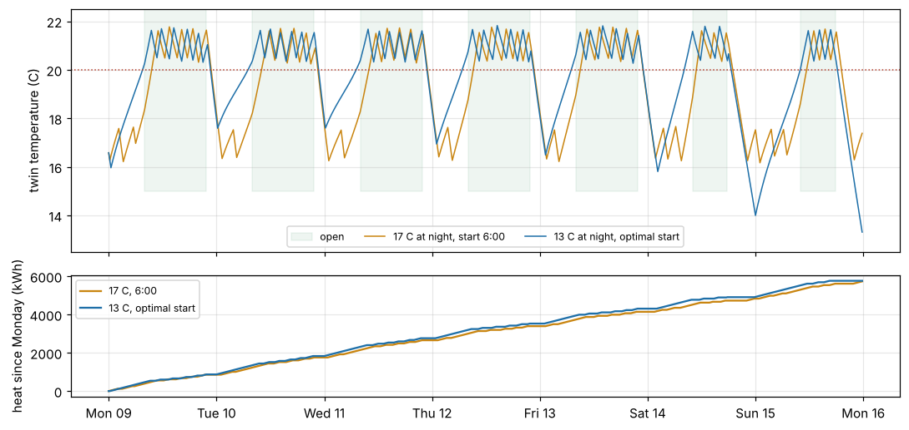
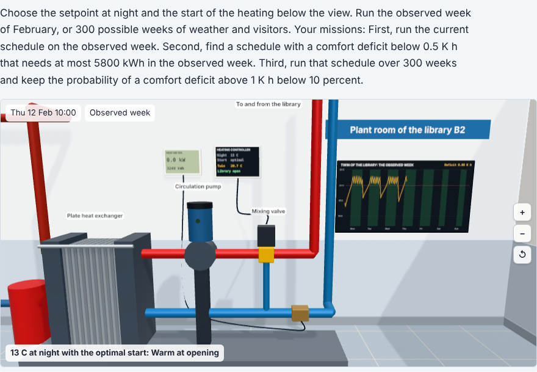

# Week 13: Digital Twins II: What-If Analysis and Predictive Maintenance

**Cyber-Physical Systems (BIL-435 Siber Fiziksel Sistemler)**  
Prof. Dr. Utku Kose, Süleyman Demirel University

   

How a digital twin answers questions about alternatives and about the future. The week puts the twin of the library into a closed loop with its thermostat. It compares heating schedules over the observed week and over 300 possible weeks drawn by Monte Carlo simulation. It then predicts the remaining useful life (RUL) of the battery of the campus, with its uncertainty, from three years of monthly capacity estimates. Finally, it plans the order of new modules. Two virtual laboratories in three dimensions (3D), the plant room of the library and the battery container, complete the week. **Estimated study time:** 8 to 9 hours.

## Materials of the week

Each material has its own role. Start with the lecture page; the study path below gives the order and the time of each step.

| Material | What it holds | Open |
|---|---|---|
| Lecture page | The concepts of the week, with a 3D scene, an animation, discussion questions, knowledge checks, the development templates, review cards and the references | [Lecture page](https://utkukose.github.io/cyber-physical-systems-NB-lecture/weeks/week-13/lecture.html) |
| Colab notebook | Python step 13: Scenarios and Monte Carlo, then six hands-on sections that compare heating schedules with the twin of the library, run them over 300 possible weeks, fit the ageing of the battery, predict its end of life with the uncertainty, plan the order of new modules and compute stage 13 of the campus microgrid, with exercises |  |
| Interactive lab | What-if and maintenance lab: Five parts, among them two 3D virtual laboratories (the plant room of the library and the battery container of the campus), a field task with the yearly capacity test of the battery, a step-by-step calculator, a self-assessment and an exportable learning log | [Interactive lab](https://utkukose.github.io/cyber-physical-systems-NB-lecture/weeks/week-13/lab.html) |
| PDF lecture notes | The Python step and the lecture in one printable file | [PDF notes](Week13_Lecture_Notes.pdf) |

<table><tr><td width="50%"> From the Colab notebook</td><td width="50%"> The interactive lab</td></tr></table>

## Learning outcomes

By the end of the week, students are expected to run a calibrated twin in a closed loop to compare decisions and to check it against observed data first. They should estimate probabilities and quantiles with the Monte Carlo method and state their standard error. They should also be able to distinguish corrective, preventive, condition-based and predictive maintenance. Finally, they should be able to predict the remaining useful life (RUL) of a battery from capacity estimates, with its uncertainty. On that basis, they should plan the order of spare parts with a stated probability of arriving in time. In Python, students are expected to loop over scenarios and to draw random numbers with NumPy.

## Study path

| Step | Activity | Suggested time |
|---|---|---|
| 1 | Read the [lecture page](https://utkukose.github.io/cyber-physical-systems-NB-lecture/weeks/week-13/lecture.html), answer its knowledge checks and think through its discussion questions | 1 hour 45 minutes |
| 2 | Run Python step 13: Scenarios and Monte Carlo in the [Colab notebook](https://colab.research.google.com/github/utkukose/cyber-physical-systems-NB-lecture/blob/main/weeks/week-13/NB13_digital_twin_whatif_maintenance.ipynb#scrollTo=python-step), right after the setup section | 45 minutes |
| 3 | Work through the two virtual laboratories of the [interactive lab](https://utkukose.github.io/cyber-physical-systems-NB-lecture/weeks/week-13/lab.html), Parts A and C, and solve Parts B and D | 1 hour 30 minutes |
| 4 | Work through Sections 1 to 5 of the Colab notebook with your own results and solve the exercises | 2 hours |
| 5 | Run one development template of the week and use the application switch of Section 6 | 45 minutes |
| 6 | Do the field task of Part E in the [interactive lab](https://utkukose.github.io/cyber-physical-systems-NB-lecture/weeks/week-13/lab.html): Run the yearly capacity test of the battery | 30 minutes |
| 7 | Take the self-assessment in the [interactive lab](https://utkukose.github.io/cyber-physical-systems-NB-lecture/weeks/week-13/lab.html) (tab: Check yourself) | 20 minutes |
| 8 | Write the reflection in the interactive lab, export the learning log and complete the weekly task below | 45 minutes |

## Live session plan

The week runs as one synchronous session of about three hours in class or online, and each material has one role in it. The lecture page is on the screen. At each orange Colab box, the instructor shows the matching section in a copy of the Colab notebook that has already been run. Students work in their own copy from top to bottom, and each part of the interactive lab follows the part of the lecture that it practises. The PDF lecture notes serve reading after the session, and the study path above serves self-paced study.

| Time | Activity |
|---|---|
| 0:00 to 0:15 | Opening: The campus microgrid so far and the question of the week, what the twins of the campus can tell about decisions and the future. Students open the Colab notebook, save a copy in Drive and run Section 0 |
| 0:15 to 0:35 | Colab, together: Python step 13, ending with probabilities from many random runs |
| 0:35 to 1:05 | Lecture page, part 1: What-if analysis with the animation of the heating schedule, the plant room of Part A and Section 1 |
| 1:05 to 1:30 | Lecture page, part 2: Many possible weeks and Section 2 |
| 1:30 to 1:40 | Break |
| 1:40 to 2:10 | Lecture page, part 3: Predictive maintenance and the remaining useful life, the calculator of Part B and Section 3 |
| 2:10 to 2:40 | Lecture page, part 4: The uncertainty of the remaining useful life with the 3D scene A fan of futures, the battery container of Part C and Section 4 |
| 2:40 to 3:00 | The development templates and the engineering side, the campus microgrid, stage 13 with Part D and Section 5, and the closing section on learning machines. After the session: Section 6, the field task of Part E, the self-assessment, the PDF notes and the weekly task |

## Weekly task and submission

**What to do.** First, choose a decision about a system that you know, such as a schedule, a setpoint or a replacement, or one system of the application switch. Second, build or reuse a model of the system and check it against observed or simulated data. Third, compare at least three alternatives over one observed period and over at least 200 random periods, with a mean, a quantile and a probability. Finally, predict the remaining useful life of one part of the system with its uncertainty and plan its replacement.

**Where to look.** Lecture: Sections "What-if analysis with the twin", "Uncertainty: Many possible weeks" and "The uncertainty of the remaining useful life". Interactive lab: Parts A and C. Colab notebook: Sections 1, 2, 4 and 6, and Exercises B and D.

**Example.** A student compares three schedules of the heating of a flat over 300 random winter weeks. A night setback with an optimal start saves 9 percent of the energy and leaves a comfort deficit above 1 K h in 4 percent of the weeks. The battery of the student's bicycle loses capacity, and the replacement is planned for the spring after next.

**What to submit.** A report of about two pages with the system, the model and its check, the alternatives with their results, the prognosis and the plan. Add the Colab notebook with the exercises of Week 13 completed.

The task is optional and supports self-learning and a personal portfolio. During an active semester, the items listed under What to submit can be sent together with the learning log exported from the interactive lab to utkukose@sdu.edu.tr or utkukose@gmail.com.

## Research and report assignment (optional)

**Digital twins for what-if analysis and predictive maintenance** How do digital twins support decisions about operation and maintenance, and how do they handle uncertainty?

**What to do.** Select eight studies published since 2015 on digital twins used for what-if analysis, prognostics or predictive maintenance of buildings, batteries or machines. For each study, note the system, the model and the decision that the twin supports. Note also how the study handles uncertainty and how it checks the predictions against reality. Compare physics-based, data-driven and hybrid approaches. Then discuss which approach you would use for the twins of the campus, and why.

**Where to start.** Lecture: Sections "What-if analysis with the twin", "Predictive maintenance and the remaining useful life" and "The uncertainty of the remaining useful life". The reviews of Jardine and co-authors and of Si and co-authors in the references give a first entry to the literature.

**Example focus.** A study may predict the remaining useful life of the bearings of a wind turbine with a twin and report the error of the prediction at several ages. Note how far ahead the prediction is useful and how the authors state its uncertainty.

The report should be about 1500 words with at least 8 sources, written in the [report template](../../exams/REPORT_TEMPLATE.docx). During an active semester, it can be sent to utkukose@sdu.edu.tr or utkukose@gmail.com.
