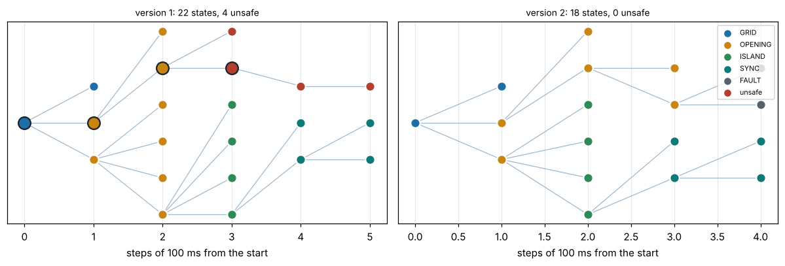
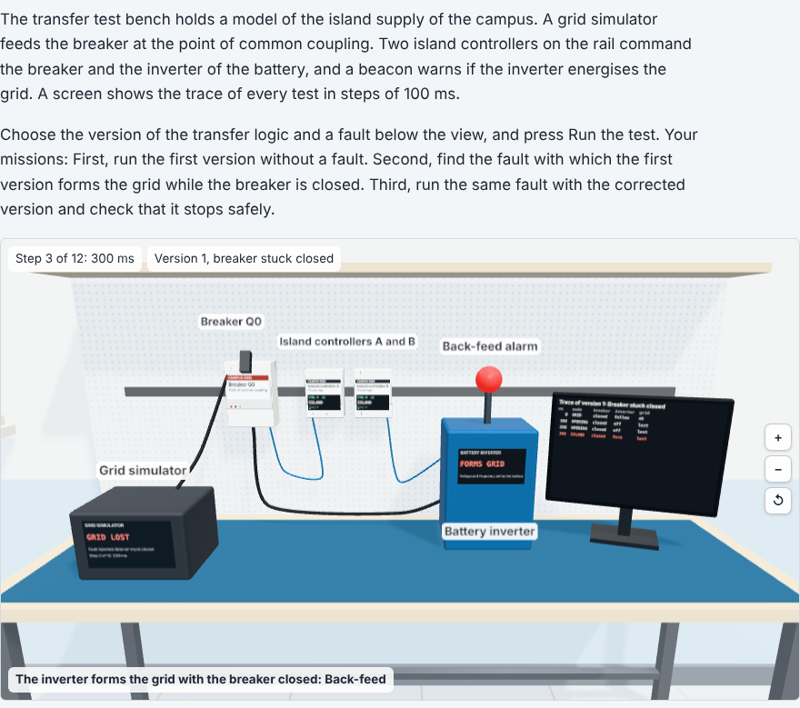

# Week 14: Dependability, Safety and Verification

**Cyber-Physical Systems (BIL-435 Siber Fiziksel Sistemler)**  
Prof. Dr. Utku Kose, Süleyman Demirel University

   

How the campus can show that its cyber-physical system keeps the critical loads supplied safely when something goes wrong. The week checks the transfer logic of the island controller against every reachable state and finds a hazard that no test had shown. It then predicts how often the parts of the island supply fail, combines them in a fault tree and chooses the cheapest design that meets the target of the campus. A runtime monitor guards the reserve of the battery, and a safety case collects the evidence. Two virtual laboratories in three dimensions (3D), a transfer test bench and the electrical room, complete the week and the course. **Estimated study time:** 8 to 9 hours.

## Materials of the week

Each material has its own role. Start with the lecture page; the study path below gives the order and the time of each step.

| Material | What it holds | Open |
|---|---|---|
| Lecture page | The concepts of the week, with a 3D scene, an animation, discussion questions, knowledge checks, the development templates, the course in review, review cards and the references | [Lecture page](https://utkukose.github.io/cyber-physical-systems-NB-lecture/weeks/week-14/lecture.html) |
| Colab notebook | Python step 14: Organised and tested code, then six hands-on sections that check the transfer logic of the island controller in every state, compute reliability and redundancy, build the fault tree of the critical supply with twelve designs and 50,000 simulated years, test a runtime monitor of the battery and assemble stage 14 of the campus microgrid, with exercises |  |
| Interactive lab | Safety and verification lab: Four parts, among them two 3D virtual laboratories (the transfer test bench and the electrical room of the campus), a step-by-step calculator, a self-assessment and an exportable learning log | [Interactive lab](https://utkukose.github.io/cyber-physical-systems-NB-lecture/weeks/week-14/lab.html) |
| PDF lecture notes | The Python step and the lecture in one printable file | [PDF notes](Week14_Lecture_Notes.pdf) |

<table><tr><td width="50%"> From the Colab notebook</td><td width="50%"> The interactive lab</td></tr></table>

## Learning outcomes

By the end of the week, students are expected to distinguish faults, errors and failures and to name the means that address them. They should be able to check a safety rule of a finite-state controller with a model checker and read its counterexample. They should also compute reliability, availability and the effect of redundancy, hidden faults and common causes. Finally, they should be able to build a fault tree, rank its basic events and choose a design against a target. In Python, students are expected to organise code in modules and to test it with assertions.

## Study path

| Step | Activity | Suggested time |
|---|---|---|
| 1 | Read the [lecture page](https://utkukose.github.io/cyber-physical-systems-NB-lecture/weeks/week-14/lecture.html), answer its knowledge checks and think through its discussion questions | 1 hour 45 minutes |
| 2 | Run Python step 14: Organised and tested code in the [Colab notebook](https://colab.research.google.com/github/utkukose/cyber-physical-systems-NB-lecture/blob/main/weeks/week-14/NB14_dependability_safety_verification.ipynb#scrollTo=python-step), right after the setup section | 45 minutes |
| 3 | Work through the two virtual laboratories of the [interactive lab](https://utkukose.github.io/cyber-physical-systems-NB-lecture/weeks/week-14/lab.html), Parts A and C, and solve Parts B and D | 1 hour 30 minutes |
| 4 | Work through Sections 1 to 5 of the Colab notebook with your own results and solve the exercises | 2 hours |
| 5 | Run one development template of the week and use the application switch of Section 6 | 45 minutes |
| 6 | Take the self-assessment in the [interactive lab](https://utkukose.github.io/cyber-physical-systems-NB-lecture/weeks/week-14/lab.html) (tab: Check yourself) | 20 minutes |
| 7 | Write the reflection in the interactive lab, export the learning log and complete the weekly task below | 45 minutes |

## Live session plan

The week runs as one synchronous session of about three hours in class or online, and each material has one role in it. The lecture page is on the screen. At each orange Colab box, the instructor shows the matching section in a copy of the Colab notebook that has already been run. Students work in their own copy from top to bottom, and each part of the interactive lab follows the part of the lecture that it practises. The PDF lecture notes serve reading after the session, and the study path above serves self-paced study.

| Time | Activity |
|---|---|
| 0:00 to 0:15 | Opening: The campus microgrid so far and the question of the week, whether the campus can trust its system when something goes wrong. Students open the Colab notebook, save a copy in Drive and run Section 0 |
| 0:15 to 0:35 | Colab, together: Python step 14, ending with the tests of the small safety monitor |
| 0:35 to 1:10 | Lecture page, part 1: Faults, errors and failures, then model checking with the 3D scene All the states of the transfer, the test bench of Part A and Section 1 |
| 1:10 to 1:30 | Lecture page, part 2: Reliability and redundancy with the animation and Section 2 |
| 1:30 to 1:40 | Break |
| 1:40 to 2:15 | Lecture page, part 3: Hidden faults, common causes and the fault tree, the calculator of Part B, the electrical room of Part C and Section 3 |
| 2:15 to 2:35 | Lecture page, part 4: Runtime monitoring and the simplex architecture with Section 4 |
| 2:35 to 3:00 | The development templates and the safety case, the campus microgrid, stage 14 with Part D and Section 5, and the course in review. After the session: Section 6, the self-assessment, the PDF notes and the weekly task |

## Weekly task and submission

**What to do.** First, choose a system that must stay safe or available when parts fail, such as one of the application switch. Second, write the safety rule of one of its controllers and check it with a model checker over a small model. Third, build the fault tree of its main hazard with at least five basic events, one hidden fault and one common cause. Finally, compare at least three designs against a target and outline the safety case.

**Where to look.** Lecture: Sections "Verification: Checking every state", "Hidden faults and common causes", "Fault trees" and "The engineering side: The safety case". Interactive lab: Parts A and C. Colab notebook: Sections 1, 3 and 6, and Exercises A and C.

**Example.** A student models the barrier controller of a railway crossing and finds that a sensor that sticks can open the barrier too early. The fault tree of the crossing shows that a second sensor helps less than expected because both share one power supply.

**What to submit.** A two-page report with the system, the safety rule and its check, the fault tree with its designs and an outline of the safety case. Add the Colab notebook with the exercises of Week 14 completed.

The task is optional and supports self-learning and a personal portfolio. During an active semester, the items listed under What to submit can be sent together with the learning log exported from the interactive lab to utkukose@sdu.edu.tr or utkukose@gmail.com.

## Research and report assignment (optional)

**Verification and safety cases for cyber-physical systems** How do formal verification, reliability analysis and safety cases work together in the assurance of cyber-physical systems?

**What to do.** Select eight studies since 2015 on model checking, fault trees, runtime monitoring or safety cases of cyber-physical systems such as power grids, vehicles or medical devices. For each study, note the system, the method, the property or the hazard and the evidence that the study produces. Note also which assumptions the evidence rests on. Then discuss how the methods complement each other, and how you would combine them for a learning-enabled controller.

**Where to start.** Lecture: Sections "Verification: Checking every state", "Fault trees", "Runtime monitoring and the simplex architecture" and "The engineering side: The safety case". The survey of fault tree analysis by Ruijters and Stoelinga in the references gives a first entry to the literature.

**Example focus.** A study may verify the controller of an insulin pump with a model checker and argue its safety in a safety case. Note which properties were checked, which hazards remained for testing and how the authors linked the evidence to the claims.

The report should be about 1500 words with at least 8 sources, written in the [report template](../../exams/REPORT_TEMPLATE.docx). During an active semester, it can be sent to utkukose@sdu.edu.tr or utkukose@gmail.com.
